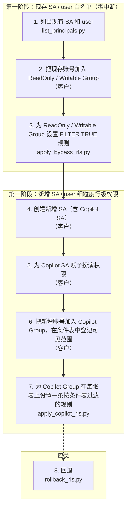

# BigQuery 行级权限（RLS）工具集

为 BigQuery 表批量设置 / 回退行级权限（Row-Level Security）的 4 个 Python 脚本，对应方案文档
「[BigQuery 行级权限 (RLS) 方案](https://docs.google.com/document/d/1SYnwBy28UIU6abcUZskOT_Quccqx5oxYlAkIIIzJ53c/edit)」中由 GCP 提供的 4 个步骤。

| 文档 | 内容 |
|---|---|
| **README.md**（本文） | 每个脚本做什么、参数、输入输出、权限要求 |
| [RUNBOOK.md](RUNBOOK.md) | 按步骤的上线操作手册、日常运维、应急回退、常见问题 |
| [TESTING.md](TESTING.md) | 测试体系（单体 / 系统 / 功能 / 性能 / 稳定性）、运行方法与最新结果 |

## 目录

- [整体流程](#整体流程)
- [文件清单](#文件清单)
- [快速开始](#快速开始)
- [通用约定](#通用约定)
- [客户维护的三张表](#客户维护的三张表)
- [脚本详解](#脚本详解)
  - [1. list_principals.py](#1-list_principalspy列出全部-sa-和-user第-1-步)
  - [2. apply_bypass_rls.py](#2-apply_bypass_rlspy白名单-group-不受行级过滤第-3-步)
  - [3. apply_copilot_rls.py](#3-apply_copilot_rlspycopilot-group-按条件表过滤第-7-步)
  - [4. rollback_rls.py](#4-rollback_rlspy回退第-8-步)
- [权限要求汇总](#权限要求汇总)
- [安全须知（信任边界）](#安全须知信任边界)
- [限制与注意事项](#限制与注意事项)
- [审计日志](#审计日志)
- [环境变量](#环境变量)

---

## 整体流程



**为什么分两个 Group**：BigQuery 的 RLS 一旦在表上建了第一条规则，**没有被任何规则授权的账号会查到 0 行**。
所以先用第 3 步给现存账号所在的 Group 建「全部可见」（`FILTER USING (TRUE)`）的规则，保证现有生产不受影响；
再用第 7 步给新增账号所在的 Copilot Group 建按条件表过滤的规则。

**为什么第 7 步是 Group 级别**：每张表最多 400 条规则（BigQuery 硬限制）。客户已有 457 个新增账号，按账号建规则会超限。
现在每张表只给 Copilot Group 建**一条**规则；过滤条件里按 `SESSION_USER()`（当前查询者）实时查条件表，
所以同一个 Group 里的 A 只看 region = US、B 只看 region = JP，互不影响。**新增账号只需加入 Group 并在条件表加一行，无需重跑脚本。**

## 文件清单

| 文件 | 说明 |
|---|---|
| `list_principals.py` | 第 1 步：列出指定组织 / 项目下的全部 SA 和 user（白名单候选），输出 CSV |
| `apply_bypass_rls.py` | 第 3 步：为一个白名单 Group 在目标表上设置 `FILTER USING (TRUE)` 规则 |
| `apply_copilot_rls.py` | 第 7 步：为 Copilot Group 在每张表上设置一条按条件表过滤的规则 |
| `rollback_rls.py` | 第 8 步：删除目标表上的 RLS 规则（按主体 / 规则名 / 全部） |
| `rls_core.py` | 纯逻辑：参数解析、规则命名、DDL 生成、计划（CREATE / NOOP / REPLACE）、CSV |
| `gcp_ops.py` | GCP 调用：BigQuery / IAM / Resource Manager / Cloud Identity / Admin SDK，含重试、限速、并行 |
| `gcp_auth.py` | 凭证：自动确定执行账号与 quota 项目，token 自动刷新 |
| `tests/` | 单体 / 系统 / 功能 / 性能 / 稳定性测试，见 [TESTING.md](TESTING.md) |

## 快速开始

```bash
# 1. Python 3.9 以上（3.9 与 3.13 均已实测）
python3 -m venv .venv && source .venv/bin/activate
pip install -r requirements.txt          # google-auth, google-api-python-client, google-cloud-bigquery

# 2. 登录执行账号，并设置默认项目（作为 quota 项目）—— 各一次即可
gcloud auth login admin@your-domain.com
gcloud config set project your-quota-project

# 3. 先演练（默认不做任何变更），确认日志后加 --apply 执行
python apply_bypass_rls.py --group group_existingsa_read@trip.com --tables tables.csv \
    --registry-table trip-bq-admin.bq_auth.adm_user_mem_copilot_tb
python apply_bypass_rls.py --group group_existingsa_read@trip.com --tables tables.csv \
    --registry-table trip-bq-admin.bq_auth.adm_user_mem_copilot_tb --apply
```

### 执行账号与 quota 项目（四个脚本相同，均可不写）

| 项 | 确定顺序 | 都取不到时 |
|---|---|---|
| 执行账号 | `--gcloud-account` → gcloud 当前活动账号（`gcloud auth login` 后的那个）→ application-default 凭证 | 退出码 2，提示 `gcloud auth login <账号>` |
| quota 项目 | `--quota-project` → gcloud 默认项目（`gcloud config set project`）→ application-default 凭证里的 quota 项目 | 退出码 2，提示 `gcloud config set project <项目ID>` |

每次运行开头打印一行 `[AUTH] 执行账号: …（来源）；quota 项目: …（来源）`，便于确认。

## 通用约定

| 项 | 约定 |
|---|---|
| 默认演练 | 三个 RLS 脚本默认**只演练**（打印将执行的 DDL，不做变更）；加 `--apply` 才执行。list_principals 只读 |
| 列表参数 | `--tables` / `--datasets` / `--projects` / `--principals` / `--policy-names` / `--organizations`：值可直接写（逗号或空格分隔），也可写 **`.csv` 文件**（单列、无表头、每行一个值；空行忽略；不支持注释），可混用；**同一参数写多次会累加** |
| `.csv` 判定 | 以 `.csv` 结尾（不区分大小写）且没有被反引号包住即当作文件；文件不存在 → 退出码 2 |
| 表名写法 | 参数和参数文件中一律 `project.dataset.table`（必须三段），**反引号可选**（可直接从 SQL / 控制台复制，如 `` `trip-prod.dw.orders` ``）；**不接受** `project:dataset.table`。数据集 `project.dataset`，同样反引号可选。（在 shell 里写反引号要加引号：`--tables '`p.d.t`'`） |
| 其它值 | 组织 = 数字 ID；项目 = Project ID；主体 = 邮箱 |
| 参数不可缩写 | 如 `--table` 不会被当作 `--tables`；已删除的旧参数传入即退出码 2 |
| `--parallel` | 同时处理的表数，默认 16；同一张表上的操作始终顺序执行。实测 32 以内吞吐线性增长、无后端错误，**建议不超过 32** |
| 逐表判断 | 无同名规则 → `[CREATE]`；同名且内容相同 → `[NOOP]`；同名但内容不同 → `[REPLACE]`（打印被覆盖的旧内容）。**重跑是安全的**：已正确的表全部 NOOP |
| 中断 | Ctrl-C：取消还没开始的表，等正在执行的几条 DDL 结束后退出（退出码 130）。每条 DDL 是原子的，不会留下半条规则；**重跑即可补齐** |
| 错误输出 | 不输出 Python 堆栈，打印 `[ERROR] <类型>: <信息>`（设 `RLS_DEBUG=1` 可看完整堆栈） |
| 暂时性错误 | 速率限制 / 后端错误 / 网络超时自动指数退避重试（总计 300 秒内） |
| 输出 CSV | UTF-8 BOM（Excel 可直接打开）；单元格做公式注入防护 |
| 运行日志 | 四个脚本每次运行都把屏幕输出**原样**另存到 **当前目录下的 `logs/<脚本名>_<YYYYMMDD_HHMMSS>.log`**（目录不存在自动创建；同一秒重名加 `_2`；永不覆盖、不自动清理）。`--log-dir <目录>` 可改保存位置。第一行 `[LOG] 日志文件: …` 提示文件位置；日志文件建不了时只打印 `[WARN]`，脚本照常运行。参数写错导致 argparse 报错、或 `--help` 时不生成。日志含账号邮箱 / 表名，`.gitignore` 已忽略 |

**退出码**（四个脚本相同）：

| 码 | 含义 |
|---|---|
| 0 | 成功 |
| 1 | 部分失败或数据有问题（其余照常处理）：DDL 失败、验证失败、登记表记录冲突、条件表数据不规范、部分范围读取失败等 |
| 2 | 参数错误 / 登记表不可用 / 无法确定执行账号或 quota 项目 / 执行时第一张表即报 Group 不存在 —— **未做任何变更** |
| 130 | 被用户中断（Ctrl-C） |

**日志前缀**：`[LOG]` 运行日志文件位置；`[AUTH]` 账号；`[SCAN]` 目标范围；`[CREATE]` / `[NOOP]` / `[REPLACE]` / `[DROP]` 逐表计划；`[SKIP]` 跳过（附原因）；
`[NOTE]` 提示（不影响退出码）；`[WARN]` 数据问题（退出码 1）；`[ERROR]` 失败；`[VERIFY-OK]` / `[VERIFY-FAIL]` 挂载后验证；`[VISIBLE]` 回退后可见行数；`[retry]` 自动重试；结尾 `=====` 之间为汇总。

**规则命名**（脚本按名字识别自己建的规则）：

| 脚本 | 规则名 |
|---|---|
| apply_bypass_rls.py | `rls_bypass_full_access_<Group 邮箱，小写，非字母数字换成 _>`，如 `rls_bypass_full_access_group_existingsa_read_trip_com` |
| apply_copilot_rls.py | `rls_copilot_<Group 邮箱，同上>`，如 `rls_copilot_group_copilot_trip_com` |

## 客户维护的三张表

> 建议放在**独立的数据集**（如 `trip-bq-admin.bq_auth`），只允许客户的权限系统写入；并在登记表中把这三张表登记为 `rls_enabled = 0`（不设置 RLS），否则 Copilot 规则里的子查询会读不到条件表。

### 条件表 `adm_user_mem_copilot_condition`（apply_copilot 读取）

每个新增 SA / user 一行，规定它能看到的维度值。

| 列 | 类型 | 说明 |
|---|---|---|
| `id` | STRING | 主键（不参与过滤） |
| `sa` | STRING | 账号邮箱：**小写、裸邮箱**（不带 `user:` / `serviceAccount:` 前缀），与 `SESSION_USER()` 精确比较 |
| `region`、`prdtype`、`refername` … | `ARRAY<STRING>`（REPEATED） | **维度**：除 `id`、`sa` 外的全部 `ARRAY<STRING>` 列都是维度（运行时读取表结构，以后加列不用改代码）；**NULL / 空数组 = 该维度全部可见** |
| `status` 等 | 非数组列 | 不是维度，不参与过滤 |

### 映射表 `adm_user_mem_copilot_tb_col_mapping`（apply_copilot 读取）

| 列 | 说明 |
|---|---|
| `table_name` | 业务表 `project.dataset.table`（只写 `dataset.table` 时项目默认取映射表所在项目） |
| `col_name` | 该业务表里的真实列名（不同表可以不同，如 `region` / `market`；支持 `a.b` 嵌套字段） |
| `to_name` | 对应的维度名，必须等于条件表某个维度列名；一张表可有多行 = 多个维度（多维度之间 AND） |

### 登记表 `adm_user_mem_copilot_tb`（apply_bypass、apply_copilot 读取）

| 列 | 说明 |
|---|---|
| `table_name` | 表名，**按原始字符串精确比较**（不做大小写 / 空格 / 反引号规范化），应写 `project.dataset.table` |
| `rls_enabled` | `1` = 设置 RLS；其它值（0 / NULL / …）= 不设置 |
| `status` 等 | 脚本不读 |

同一 `table_name` 有多行且 `rls_enabled` 不一致 → `[WARN]` + `[SKIP]`，退出码 1。rollback_rls.py **不看**登记表（登记表改为 0 之后，正需要用它删除规则）。

---

## 脚本详解

### 1. list_principals.py：列出全部 SA 和 user（第 1 步）

列出指定组织 / 项目下的**全部** SA 和 user，作为白名单候选，供客户审核后加入 ReadOnly / Writable Group。只读，不做任何变更。
**全部使用权威 API（不使用 Cloud Asset Inventory**——实测其 SA 搜索索引会漏账号）。

**参数**

| 参数 | 说明 |
|---|---|
| `--organizations` | 组织数字 ID（值或 .csv） |
| `--projects` | Project ID（值或 .csv）；可与组织叠加，至少给一类 |
| `--exclude-members` | 从输出中去掉这些邮箱 |
| `--exclude-patterns` | 从输出中去掉匹配通配符的邮箱，如 `'copilot-*@*'` |
| `-o` | 输出 CSV，默认 `principals.csv` |
| `--parallel` | 并发数，默认 16 |
| `--gcloud-account` / `--quota-project` | 可选，见[快速开始](#执行账号与-quota-项目四个脚本相同均可不写) |

**来源（取并集去重）**

1. **SA 清单**：范围内每个 ACTIVE 项目用 IAM `serviceAccounts.list` 列出全部 SA（含已禁用、没有任何授权的）。组织范围先用 Resource Manager 递归列出全部文件夹和项目；待删除的项目跳过并 `[NOTE]`。
2. **账号目录**（只在指定 `--organizations` 时）：Admin SDK Directory API 列出组织账号目录里的全部 user（含暂停 / 归档、所有域名）。
3. **BigQuery 相关授权**：组织 / 文件夹 / 项目 IAM 策略（只指定项目时，同样读取该项目全部上级文件夹 / 组织的策略，不漏继承的授权；效果同 Console 项目 IAM 页面的「继承」行）、每个数据集的 ACL、每张表 / 视图的 IAM 策略；只纳入能读表数据的角色：含 `bigquery.tables.getData` 的角色，以及**基本角色 Owner / Editor / Viewer**（它们的 IAM 权限里没有这一项，但每个数据集的 ACL 默认带特殊组 `projectOwners` / `projectWriters` / `projectReaders`，项目的基本角色持有者借此能读表，所以一律按能读表处理，不管授在项目、文件夹还是组织上）。用于找出其它项目的 SA、外部域的 user、Google 服务代理（如默认在每个项目上有 Editor 的 `<项目编号>@cloudservices.gserviceaccount.com`）。其中的 Group 递归展开。
4. **授权视图 / 数据集 / 例程**（只提示）：数据集 ACL 中授权了其它项目的视图 / 数据集 / 例程读取本数据集时，能查询它们的人也能间接读到数据；这些项目不在本次扫描范围内时打印 `[NOTE]` 列出，需要的话把它们加入 `--projects` 重跑。

跳过 `deleted:`、`domain:`、`allUsers`、`allAuthenticatedUsers`、授权视图 / 例程 / 数据集等非具体账号。任何读取失败都 `[ERROR]` 并以退出码 1 结束（其余结果照常写入），绝不悄悄跳过。

**展不开的 Group**：一律作为 `principal_type = group` 写入 CSV（成员未展开），按域名分两类：

| Group | 处理 | 退出码 |
|---|---|---|
| 外部域（不属于本组织域名）：Cloud Identity 不允许读取其它组织的 Group，超级管理员也读不到 | `[NOTE]` | 不影响 |
| 本组织域名的 Group 读不到（多半缺「群组 → 读取」权限），或展开出错（API 未启用、限流重试用尽等） | `[ERROR]` | 1 |

本组织域名 = 组织的主域名（组织显示名称）+ 账号目录里 user 的域名（只在组织范围）+ 跑脚本账号的域名（SA 除外），日志 `[DOMAIN]` 行列出。只指定项目时不读账号目录，辅助域名（如 `ctrip.com`）的 Group 会按外部域处理（照样写入 CSV）。

**输出**：CSV 三列 `email, principal_type, home_project`；`principal_type` ∈ `serviceAccount` / `user` / `serviceAgent` / `group`（展不开的 Group）；`home_project` 由 SA 邮箱反推（user / 服务代理 / group 为空）。

```bash
python list_principals.py --organizations 123456789012
python list_principals.py --projects trip-prod,trip-etl --exclude-patterns 'copilot-*@*' -o existing.csv
```

### 2. apply_bypass_rls.py：白名单 Group 不受行级过滤（第 3 步）

为**一个**白名单 Group 在目标表上建 `FILTER USING (TRUE)` 规则：组内成员不受行级过滤、可见全部记录（前提是本来就有读表权限；**本脚本不授予读表权限**）。ReadOnly、Writable 各运行一次。

```sql
CREATE OR REPLACE ROW ACCESS POLICY `rls_bypass_full_access_group_existingsa_read_trip_com`
ON `trip-prod.dw.orders`
GRANT TO ("group:group_existingsa_read@trip.com")
FILTER USING (TRUE)
```

**参数**

| 参数 | 说明 |
|---|---|
| `--group`（必填） | 白名单 Group 邮箱，只能一个 |
| `--registry-table`（必填） | 登记表 `project.dataset.table` |
| `--tables` / `--datasets` / `--projects` | 目标范围（值或 .csv），可叠加，**至少给一类**；数据集 / 项目展开时只取普通表（视图跳过） |
| `--verify-sa` | 可选：执行后扮演该 Group 里的一个 SA 查表，300 秒内查到任意一行即通过；SA 无法扮演时立即失败 |
| `--parallel` | 默认 16 |
| `--apply` | 真正执行 |
| `--gcloud-account` / `--quota-project` | 可选 |

**双重保证**：最终表 = （`--tables` ∪ `--datasets` 展开 ∪ `--projects` 展开）**∩ 登记表 `rls_enabled = 1` 的表**。不在登记表 / 未开启的表逐张 `[SKIP]`（退出码不受影响）。

**首次设置提示**：表上原本没有任何规则时，新建第一条会让其它未被授权的账号查到 0 行；这些表在日志中以 `[NOTE]` 列出（「将为以下这些表首次设置RLS规则」），只提示、不拦截。

```bash
python apply_bypass_rls.py --group group_existingsa_read@trip.com --tables tables.csv \
    --registry-table trip-bq-admin.bq_auth.adm_user_mem_copilot_tb --apply
python apply_bypass_rls.py --group group_existingsa_write@trip.com --datasets trip-prod.dw trip-prod.ods \
    --registry-table trip-bq-admin.bq_auth.adm_user_mem_copilot_tb --apply --verify-sa etl@trip-prod.iam.gserviceaccount.com
```

### 3. apply_copilot_rls.py：Copilot Group 按条件表过滤（第 7 步）

每张表给 `--group` 建**一条**规则，组内每个 SA / user 按条件表各自只看到规定的数据。

**参数**

| 参数 | 说明 |
|---|---|
| `--group`（必填） | Copilot Group 邮箱，只能一个；多个 Copilot Group 各运行一次 |
| `--condition-table`（必填） | 条件表 |
| `--mapping-table`（必填） | 映射表 |
| `--registry-table`（必填） | 登记表 |
| `--tables` | 可选：只处理这些表（值或 .csv） |
| `-o` | 审核 CSV，默认 `copilot_rls_plan.csv` |
| `--parallel` / `--apply` / `--gcloud-account` / `--quota-project` | 同上 |

**处理逻辑**

1. **维度** = 条件表中除 `id`、`sa` 外的 `ARRAY<STRING>` 列。
2. **选表**：映射表中 `to_name` 属于维度的行（一张表多行 = 多个维度）∩ 登记表 `rls_enabled = 1`；未开启 / 未登记的表 `[SKIP]`；登记为开启但没有任何校验维度的表 `[SKIP]`。映射列不存在 / 是数组 / 是 RECORD → 跳过该表；表本身不存在（如已被 drop）→ `[SKIP] 表不存在`，其余表照常，退出码 1。
3. **每张表一条规则**，`GRANT TO ("group:<group>")`，过滤条件与客户 sample 写法相同——每个维度一段、多段 AND：

```sql
CREATE OR REPLACE ROW ACCESS POLICY `rls_copilot_group_copilot_trip_com`
ON `trip-prod.dw.orders`
GRANT TO ("group:group_copilot@trip.com")
FILTER USING (
  (`region` IN (SELECT v FROM `trip-bq-admin.bq_auth.adm_user_mem_copilot_condition` AS c, UNNEST(c.region) AS v
                WHERE c.sa = SESSION_USER())
   OR EXISTS (SELECT 1 FROM `trip-bq-admin.bq_auth.adm_user_mem_copilot_condition` AS c
              WHERE c.sa = SESSION_USER() AND (c.region IS NULL OR ARRAY_LENGTH(c.region) = 0)))
  AND
  (`prd_type` IN (SELECT v FROM `…condition` AS c, UNNEST(c.prdtype) AS v WHERE c.sa = SESSION_USER())
   OR EXISTS (SELECT 1 FROM `…condition` AS c WHERE c.sa = SESSION_USER() AND (c.prdtype IS NULL OR ARRAY_LENGTH(c.prdtype) = 0)))
)
```

（`col_name` 来自映射表，`c.<维度>` 来自 `to_name`；非 STRING 列自动 `CAST(... AS STRING)`。）

**什么时候需要重跑**

| 变化 | 是否重跑 |
|---|---|
| 新增账号（加入 Group + 条件表加一行） | **不用** |
| 修改某账号的可见范围（改条件表） | **不用**（实时生效） |
| 撤销账号（移出 Group 或删除条件表行） | **不用** |
| 新增业务表、改映射维度、登记表开启新表、条件表新增维度列 | 要（只会 CREATE / REPLACE 有变化的表，其余 NOOP） |

**账号生效的前提**（脚本不检查，由客户维护）：① 账号在 `--group` 里；② 条件表里有该账号的行；③ `--group` 对条件表有读权限（BigQuery 以查询者身份执行子查询；因此组内成员能读到整张条件表）。

**数据校验**（只提醒，规则照建）：条件表 `sa` 值非小写 / 有首尾空白 / 带前缀 / 不是邮箱（这些账号永远匹配不到，查到 0 行）、同一 `sa` 多行（各维度独立判断会出现交叉组合）→ `[WARN]`、退出码 1；条件表为空 → `[NOTE]`。

**输出**：审核 CSV，每张表一行，只含 CREATE / REPLACE：`table, policy_name, action, dimensions, filter, note`（执行模式另加 `result`）；REPLACE 时 `note` 记录旧内容。

```bash
python apply_copilot_rls.py --group group_copilot@trip.com \
    --condition-table trip-bq-admin.bq_auth.adm_user_mem_copilot_condition \
    --mapping-table   trip-bq-admin.bq_auth.adm_user_mem_copilot_tb_col_mapping \
    --registry-table  trip-bq-admin.bq_auth.adm_user_mem_copilot_tb            # 演练，看 copilot_rls_plan.csv
python apply_copilot_rls.py ...同上... --apply
```

> [!NOTE]
> 表上原本没有任何规则时，Copilot 规则会让现存账号查到 0 行（日志 `[NOTE]` 列出这些表）。正常流程中第 3 步已为现存账号的 Group 建好 bypass 规则；如有遗漏，用 apply_bypass_rls.py 补上即可。

### 4. rollback_rls.py：回退（第 8 步）

删除目标表上的 RLS 规则。

| 参数 | 说明 |
|---|---|
| `--tables` / `--datasets` / `--projects` | 目标范围（必填至少一类，可叠加） |
| `--principals` | 邮箱（Group / SA / user 均可，不分类型）：删除**授权对象里含这些邮箱**的规则（能覆盖手工建的规则） |
| `--policy-names` | 规则名 |
| `--verify-sa` | 可选：删除后扮演该 SA 逐表查询，打印「可见 N 行 / 表共 M 行」，只报告不判定 |
| `--parallel` / `--apply` / `--gcloud-account` / `--quota-project` | 同上 |

- `--principals` 与 `--policy-names` 同时给出时取**交集**；**两者都不给 = 删除目标表上的全部规则**。
- 某张表的规则将被全部删除时（删除后所有有读表权限的账号都能看到全部数据），日志 `[NOTE]` 列出，只提示不拦截；此时用 `DROP ALL ROW ACCESS POLICIES`。
- 演练和执行都逐条打印被删除规则的完整内容（表、规则名、授权对象、过滤条件）和 DDL，可代替备份用于事后追查。

```bash
python rollback_rls.py --datasets trip-prod.dw --principals group_copilot@trip.com --apply        # 撤销 Copilot 规则
python rollback_rls.py --tables tables.csv --policy-names rls_bypass_full_access_group_existingsa_read_trip_com --apply
python rollback_rls.py --tables tables.csv --apply                                                 # 删除这些表上的全部规则
```

---

## 权限要求汇总

与 [RUNBOOK 0.2](RUNBOOK.md#02-授予跑脚本的-user--sa-权限一次) 一致：跑脚本的 user / SA 被授予下面这些权限后，便可运行四个脚本（已在测试环境用新建、无任何权限的 user 和 SA 各实测一遍）。

| # | 在哪里 | 授予跑脚本的 user / SA | 用于 |
|---|---|---|---|
| 1 | quota 项目（APIs & Services） | 启用 API：`cloudresourcemanager`、`iam`、`bigquery`、`cloudidentity`、`admin`、`iamcredentials` | 全部脚本 |
| 2 | admin.google.com（Workspace / Cloud Identity） | 自定义管理员角色，只勾 **Users → Read**、**Groups → Read** | 第 1 步：列出账号目录中的 user、展开 Group 成员 |
| 3 | 组织层级 IAM | **Browser**、**Security Reviewer**、**BigQuery Metadata Viewer** | 第 1 步：遍历项目、列出 SA、读取各层级 IAM 与 BigQuery 授权 |
| 4 | quota 项目 IAM | **Service Usage Consumer** | 全部脚本：以 quota 项目的名义调用 API（缺少时所有调用报 403 `USER_PROJECT_DENIED`） |
| 5 | quota 项目 IAM | **BigQuery Job User** | 第 3、7、8 步：运行查询与 DDL |
| 5 | 业务表所在项目（或数据集） | **BigQuery Data Owner** | 第 3、7、8 步：创建、修改、删除行级规则 |
| 5 | 三张控制表所在项目（或数据集） | **BigQuery Data Viewer** | 第 3、7 步：读取登记表、条件表、映射表 |
| 6 | 登录方式 | user：`gcloud auth login`；SA：由运维人员扮演（需对该 SA 有 Service Account Token Creator，`gcloud config set auth/impersonate_service_account <SA>`），或在挂载该 SA 的 GCE 虚拟机 / Cloud Run 上运行 | 全部脚本 |

可选：使用 `--verify-sa` 或按 RUNBOOK「验收」以某个 SA 身份查表时，需在该 SA 上给跑脚本的 user / SA 授予 **Service Account Token Creator**。

## 安全须知（信任边界）

- **条件表 / 映射表 / 登记表是 RLS 的控制平面**：谁能写这三张表，谁就能决定每个 Copilot 账号看到哪些行、哪些表设置 RLS。必须只允许客户的权限系统写入。
- **维度为空数组 = 该维度全部可见**：录入失误会放大权限，审核条件表时要特别注意。
- 账号不在条件表中 → 0 行（安全的默认）；条件表 `sa` 大小写不一致 → 0 行（`[WARN]` 提醒）。
- 规则按名字识别：手工创建 / 改名的规则不在 apply_* 的识别范围内；rollback `--principals` 按授权对象匹配，能覆盖手工规则。
- 视图不支持 RLS；直接列出视图会在该表上失败（退出码 1），不影响其它表。

## 限制与注意事项

- **Copilot Group 成员能读整张条件表**：规则里的子查询以查询者身份执行，所以 Copilot Group 必须有条件表的读权限，组内每个账号因此都能看到所有账号的可见范围。这是 BigQuery 子查询规则的固有特性（被规则引用的表不能再加 RLS），请知悉。
- **REPLACE 时有极短的无过滤窗口**：规则内容变化时脚本用 `CREATE OR REPLACE ROW ACCESS POLICY` 覆盖。若该表上只有这一条规则，BigQuery 官方说明替换瞬间可能短暂不过滤。首次设置或 NOOP 不受影响；如需避免，可在业务低峰执行。
- **rollback 不要与 apply 同时对同一批表运行**：rollback 先读取规则再删除，「这张表的规则将被全部删除」的判断在读取时做出；同时有 apply 在建规则时，判断可能与执行时的实际情况不一致。
- **list_principals 的覆盖范围**：不列出 `domain:`（整个域）、`allUsers` / `allAuthenticatedUsers`（公开）、`principal://` / `principalSet://`（Workforce / Workload Identity Federation）这类非具体账号的授权；不扫描 Analytics Hub 订阅（linked dataset）和其它组织中的授权视图。基本角色一律按能读表处理，个别数据集若删掉了默认特殊组，会多列几个其实读不到这些表的人（宁可多列）。
- **list_principals 读不到某个自定义角色的定义时按「能读表数据」处理**：打印 `[WARN]`，其成员照常列入 CSV，退出码不因此变为 1。这是有意的「宁可多列、不可漏列」，与其它读取失败（`[ERROR]` + 退出码 1）不同。
- **映射表 `col_name` 不区分大小写**：与 BigQuery 列名规则一致（`Region` 与 `region` 视为同一列），生成的过滤条件使用表中的真实写法。
- **Group 写错或刚创建尚未同步**：执行时 BigQuery 报「Group … does not exist」，脚本不再等待重试——第一张需要变更的表失败即停止，其余表都不执行（退出码 2，未做任何变更）。Group 刚创建或刚改过成员时，等几分钟后重跑即可。演练不执行 DDL，发现不了这类问题。

## 审计日志

脚本自己的运行过程（含被跳过的表及原因）保存在运行日志 `logs/*.log`（见[通用约定](#通用约定)）；**实际执行的**规则变更另由 BigQuery 自带的 Cloud Audit Logs 记录（管理活动日志，始终开启、免费、保留 400 天）。
在 Logs Explorer（表所在项目）中查询：

```
protoPayload.serviceName="bigquery.googleapis.com"
(protoPayload.metadata.rowAccessPolicyCreation:* OR protoPayload.metadata.rowAccessPolicyChange:*
 OR protoPayload.metadata.rowAccessPolicyDeletion:*)
```

或命令行：

```bash
gcloud logging read 'protoPayload.serviceName="bigquery.googleapis.com" AND protoPayload.metadata.rowAccessPolicyDeletion:*' \
    --project trip-prod --freshness 7d \
    --format='value(timestamp,protoPayload.resourceName,protoPayload.authenticationInfo.principalEmail)'
```

## 环境变量

| 变量 | 默认 | 作用 |
|---|---|---|
| `RLS_DEBUG` | 未设置 | 设为 `1` 时出错打印完整 Python 堆栈 |
| `RLS_IAM_RPM` | 1200 | 读取规则授权对象（getIamPolicy）的全局限速（次 / 分钟）；BigQuery 配额为 1500 |
| `RLS_HTTP_TIMEOUT` | 120 | 单个 HTTP 请求超时（秒） |
