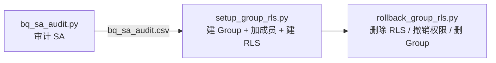

# BigQuery Service Account 审计与 RLS 管理工具集

本目录包含三个 Python 脚本和一个公共认证模块，用于：

1. **审计**：找出项目里的所有 Service Account (SA)，判断它们是否有 BigQuery 权限、是否提交过 BigQuery 作业。
2. **授权**：根据审计结果，把 SA 加入一个 Google Group，并在指定表上创建 Row-Level Security (RLS)，让这个 group 能访问全部行。
3. **回退**：删除表上与指定 group 相关的 RLS；不指定 group 时删除表上的全部 RLS。



---

## 目录

- [文件清单](#文件清单)
- [通用前置条件](#通用前置条件)
  - [本地环境](#本地环境)
  - [认证方式](#认证方式)
  - [Quota Project（计费/配额项目）](#quota-project计费配额项目)
  - [需要启用的 API](#需要启用的-api)
- [1. bq_sa_audit.py：SA 审计](#1-bq_sa_auditpysa-审计)
- [2. setup_group_rls.py：创建 Group 和 RLS](#2-setup_group_rlspy创建-group-和-rls)
- [3. rollback_group_rls.py：回退 RLS](#3-rollback_group_rlspy回退-rls)
- [权限速查总表](#权限速查总表)
- [最小权限自定义角色示例](#最小权限自定义角色示例)
- [RLS 行为须知（务必阅读）](#rls-行为须知务必阅读)
- [常见问题排查](#常见问题排查)
- [测试记录](#测试记录)

---

## 文件清单

| 文件 | 说明 |
|---|---|
| [bq_sa_audit.py](bq_sa_audit.py) | SA 审计脚本，输出终端表格和 CSV |
| [setup_group_rls.py](setup_group_rls.py) | 创建 Group、加入 SA、创建 RLS，可选授予表级读权限 |
| [rollback_group_rls.py](rollback_group_rls.py) | 删除 RLS，可选撤销表级读权限、删除 Group |
| [gcp_auth.py](gcp_auth.py) | 公共认证模块：使用 ADC，或指定一个 gcloud 账号 |
| [requirements.txt](requirements.txt) | Python 依赖 |
| `bq_sa_audit.csv` | 审计脚本的输出，供 `setup_group_rls.py` 读取 |

---

## 通用前置条件

### 本地环境

| 项目 | 要求 |
|---|---|
| Python | 3.9 及以上（开发和测试用的是 3.11） |
| Python 依赖 | `pip install -r requirements.txt`，包含 `google-auth`、`google-api-python-client`、`google-cloud-bigquery` |
| Google Cloud CLI | 已安装 `gcloud`。使用 `--gcloud-account` 时必需；排查问题时也会用到 `bq` |
| 网络 | 能访问 `*.googleapis.com` |

```bash
pip install -r requirements.txt
gcloud --version
```

### 认证方式

三个脚本都支持两种认证方式，由 [gcp_auth.py](gcp_auth.py) 统一处理。

**方式 A：Application Default Credentials (ADC)，默认**

```bash
gcloud auth application-default login
# 可选：设置 ADC 的 quota project
gcloud auth application-default set-quota-project <PROJECT_ID>
```

**方式 B：`--gcloud-account <账号>`，推荐在有多个账号时使用**

脚本会调用 `gcloud auth print-access-token --account=<账号>` 获取 token。这个账号需要先用 `gcloud auth login` 登录过：

```bash
gcloud auth login admin@your-domain.com
gcloud auth list          # 确认账号已在列表中
```

> [!NOTE]
> 方式 B 拿到的 access token 有效期约 **1 小时**。扫描范围很大、运行超过 1 小时的任务，请改用方式 A。

> [!TIP]
> 如果 ADC 登录的是 A 账号，而目标项目只有 B 账号有权限（比如 ADC 是公司账号，目标项目属于另一个 Cloud Identity 域），直接用 `--gcloud-account B`，不需要重新执行 ADC 登录。

### Quota Project（计费/配额项目）

用**用户账号**调用 Google API 时，请求会带上一个 quota project，API 的配额和计费都记在这个项目上。调用者必须满足：

- 在 quota project 上有 `serviceusage.services.use` 权限（角色 `roles/serviceusage.serviceUsageConsumer`；`roles/editor` 和 `roles/owner` 也包含这个权限）。
- 要调用的 API 已在 quota project 上**启用**。

各脚本使用的 quota project：

| 脚本 | Quota project |
|---|---|
| `bq_sa_audit.py` | `--quota-project`；不指定时使用 ADC 自带的 quota project |
| `setup_group_rls.py` | `--project`，默认是 `--table` 所在的项目 |
| `rollback_group_rls.py` | `--quota-project`；默认是第一个表、数据集或项目所在的项目 |

> [!WARNING]
> 如果 ADC 的默认 quota project 不是当前账号能用的项目，所有请求都会返回
> `403 USER_PROJECT_DENIED ... Caller does not have required permission to use project X`。
> 解决办法：显式指定 `--quota-project`，或者用 `gcloud auth application-default set-quota-project` 修改 ADC 的设置。

### 需要启用的 API

| API | 服务名 | 哪些脚本用 |
|---|---|---|
| BigQuery API | `bigquery.googleapis.com` | 三个脚本都用 |
| Identity and Access Management (IAM) API | `iam.googleapis.com` | `bq_sa_audit.py` |
| Cloud Resource Manager API | `cloudresourcemanager.googleapis.com` | `bq_sa_audit.py`；`setup_group_rls.py` 在自动获取 customer ID 时用 |
| Cloud Identity API | `cloudidentity.googleapis.com` | `setup_group_rls.py`；`rollback_group_rls.py` 在使用 `--delete-group` 时用 |

在 quota project 上启用（需要 `serviceusage.services.enable` 权限，例如 `roles/serviceusage.serviceUsageAdmin` 或 Owner）：

```bash
gcloud services enable bigquery.googleapis.com iam.googleapis.com \
    cloudresourcemanager.googleapis.com cloudidentity.googleapis.com \
    --project=<QUOTA_PROJECT>
```

---

## 1. bq_sa_audit.py：SA 审计

### 功能

对输入的每个项目：

1. **列出所有 SA**：调用 IAM API `projects.serviceAccounts.list`。
2. **判断 SA 是否有任何 BigQuery 权限**：
   - **项目级 IAM**：读取每个输入项目的 IAM Policy，把 SA 绑定的每个角色展开成具体权限。只要包含任意 `bigquery.*` 权限就算有。所以 `roles/owner`、`roles/editor`、`roles/viewer` 和自定义角色都能识别出来。角色展开结果会缓存。
   - **跨项目**：会在**所有输入项目**里查找。A 项目的 SA 在 B 项目里被授了 BQ 角色，也会被识别出来。
   - 带 IAM Condition 的绑定会标记为 `(conditional)`。
   - **数据集级 ACL**（可选，`--check-datasets`）：逐个读取每个数据集的 access entries。
3. **判断 SA 是否提交过作业**：在每个输入项目的每个区域上查询
   `` `<project>`.`region-<region>`.INFORMATION_SCHEMA.JOBS ``，按 `user_email` 统计作业数和最近一次作业时间。
   - **区域自动识别**：不指定 `--regions` 时，扫描所有输入项目里数据集的 location，去重合并后使用；什么都没识别到时回退为 `us`。
   - `--extra-regions` 可以在识别结果之外再追加区域，用来补上"只有作业、没有数据集"的区域。

### 参数

| 参数 | 说明 | 默认值 |
|---|---|---|
| `--projects P1 P2 ...` | 项目 ID 列表（与 `--projects-file` 二选一） | — |
| `--projects-file FILE` | 每行一个项目 ID，`#` 开头为注释 | — |
| `--regions R1 R2 ...` | 手动指定区域，例如 `us eu asia-east1`（小写，不带 `region-` 前缀） | 自动识别 |
| `--extra-regions R ...` | 额外追加的区域 | 无 |
| `--days N` | 查询最近 N 天的作业（JOBS 视图最多保留 180 天） | 180 |
| `--check-datasets` | 同时检查数据集级 ACL，较慢 | 关闭 |
| `-o / --output FILE` | CSV 输出路径 | `bq_sa_audit.csv` |
| `--quota-project P` | 覆盖 quota project | ADC 自带 |
| `--gcloud-account ACC` | 使用指定 gcloud 账号 | 使用 ADC |

### 示例

```bash
python bq_sa_audit.py --projects my-project \
    --gcloud-account admin@example.com --quota-project my-project

python bq_sa_audit.py --projects-file projects.txt --extra-regions asia-east2 --check-datasets -o result.csv
```

### 输出字段（CSV）

| 字段 | 含义 |
|---|---|
| `project` | SA 所属项目 |
| `service_account` | SA 邮箱 |
| `display_name` / `disabled` | SA 显示名、是否已禁用 |
| `has_bq_permission` | 是否有任何 BQ 权限（项目级 IAM 或数据集 ACL） |
| `bq_iam_roles` | 含 BQ 权限的项目级角色，格式 `项目:角色` |
| `bq_dataset_acls` | 数据集级授权，格式 `项目.数据集:角色`（需加 `--check-datasets`） |
| `has_submitted_jobs` / `job_count` / `last_job_time` | 是否提交过作业、作业数、最近一次作业时间 |
| `job_locations` | 在哪些 `项目/区域` 提交过作业 |

### 运行者所需权限

**每个被审计的项目**都需要下面的权限：

| 用途 | 权限 | 可用的预定义角色 |
|---|---|---|
| 列出 SA | `iam.serviceAccounts.list` | `roles/iam.serviceAccountViewer`、`roles/iam.securityReviewer` |
| 读取项目 IAM Policy | `resourcemanager.projects.getIamPolicy` | `roles/iam.securityReviewer`、`roles/resourcemanager.projectIamAdmin` |
| 展开**项目级**自定义角色 | `iam.roles.get`（在项目上） | `roles/iam.securityReviewer`、`roles/iam.roleViewer` |
| 展开**组织级**自定义角色 | `iam.roles.get`（在组织上） | 组织级的 `roles/iam.roleViewer` |
| 识别数据集区域 | `bigquery.datasets.get`（列出数据集） | `roles/bigquery.metadataViewer`、`roles/bigquery.dataViewer` |
| 查询 `INFORMATION_SCHEMA.JOBS` | `bigquery.jobs.listAll` | `roles/bigquery.resourceViewer`、`roles/bigquery.admin` |
| 运行上面的查询作业 | `bigquery.jobs.create`（作业在**被审计项目**里运行） | `roles/bigquery.jobUser`、`roles/bigquery.user` |
| `--check-datasets` | `bigquery.datasets.get` | `roles/bigquery.metadataViewer` |

**Quota project** 上还需要 `serviceusage.services.use`（见[上文](#quota-project计费配额项目)）。

> [!TIP]
> 推荐的组合：每个被审计项目授予 `roles/iam.securityReviewer` + `roles/bigquery.resourceViewer` + `roles/bigquery.jobUser` + `roles/bigquery.metadataViewer`。

> [!NOTE]
> 预定义角色（`roles/...`）的权限列表是公开的，展开时不需要额外权限。拿不到某个角色的权限列表时，脚本会打印 WARN，并改为按角色名里有没有 "bigquery" 粗略判断。

### 局限

- **Folder 和 Organization 层**继承下来的 IAM 不在统计范围内。需要的话可以改用 Policy Analyzer（`gcloud asset analyze-iam-policy`）。
- `INFORMATION_SCHEMA.JOBS` 最多只保留 **180 天**，并且按区域存放。没有列进去的区域里的作业统计不到。
- 统计的是作业的**提交者**（`user_email`）。SA 是通过 impersonation 被别人使用的，同样会算到这个 SA 上。
- 按资源授予的权限不在统计范围内，例如表级 IAM、通过授权视图访问。

---

## 2. setup_group_rls.py：创建 Group 和 RLS

### 功能

1. 读取 `bq_sa_audit.csv`，按 `--members` 选出 SA：`all` 为全部；`bq` 为 `has_bq_permission=True` 的；`jobs` 为 `has_submitted_jobs=True` 的。
2. 通过 **Cloud Identity API** 创建 Google Group；group 已存在则直接复用。
   - Group 的父级是 `customers/<customer ID>`。customer ID 默认根据 `--project` 所属组织自动获取，也可以用 `--customer-id` 指定。
   - 使用 `WITH_INITIAL_OWNER` 创建，**运行脚本的账号会自动成为 group 的 OWNER 兼 MEMBER**。
3. 把选中的 SA 以 `MEMBER` 身份加入 group；已经是成员的跳过。
4. 在目标表上执行：
   ```sql
   CREATE OR REPLACE ROW ACCESS POLICY `<policy-name>`
   ON `<project.dataset.table>`
   GRANT TO ("group:<group-email>")
   FILTER USING (TRUE)
   ```
5. 可选 `--grant-table-viewer`：给 group 授予**表级** `roles/bigquery.dataViewer`。RLS 只决定能看到哪些行，本身**不授予**读表权限。

脚本可以重复执行。默认 **dry-run**，加 `--apply` 才真正执行。

### 参数

| 参数 | 说明 | 默认值 |
|---|---|---|
| `--audit-csv FILE` | **必填**，审计脚本输出的 CSV | — |
| `--members all\|bq\|jobs` | 选择哪些 SA | `bq` |
| `--group-email EMAIL` | **必填**，group 邮箱，域名必须属于该 Cloud Identity 客户 | — |
| `--group-display-name` | group 显示名 | 同邮箱 |
| `--customer-id C0xxxx` | Cloud Identity customer ID | 自动获取 |
| `--table P.D.T` | **必填**，要创建 RLS 的表 | — |
| `--project P` | quota project，也是运行 DDL 的项目 | 表所在项目 |
| `--policy-name` | RLS 名称 | `sa_group_all_rows` |
| `--grant-table-viewer` | 授予 group 表级 `dataViewer` | 关闭 |
| `--skip-group` | 跳过建 group 和加成员，只建 RLS | 关闭 |
| `--force-first-policy` | 表上原本**没有任何 RLS** 时，必须加这个参数才会执行 | 关闭 |
| `--gcloud-account ACC` | 使用指定 gcloud 账号 | 使用 ADC |
| `--apply` | 真正执行 | dry-run |

### 示例

```bash
# 先 dry-run
python setup_group_rls.py \
    --audit-csv bq_sa_audit.csv --members bq \
    --group-email bq-sa-all-rows@example.com \
    --table my-project.my_dataset.my_table_rls_test \
    --gcloud-account admin@example.com --grant-table-viewer

# 确认后执行
python setup_group_rls.py ...同上... --force-first-policy --apply
```

### 运行者所需权限

#### A. Cloud Identity / Google Workspace 管理权限（建 group、加成员）

这一部分**不是 GCP IAM 角色**，要在 **Google Admin Console**（admin.google.com）里分配：

| 操作 | 所需权限 |
|---|---|
| 创建 group（`groups.create`） | 下面任意一种：<br/>• **Super Admin**<br/>• 预置管理员角色 **Groups Admin**<br/>• 自定义管理员角色，勾选 Admin API Privileges → Groups → **Create / Read / Update** |
| 查询 group（`groups.lookup`） | 上面任意角色；或者是该 group 的成员 |
| 列出和添加成员（`memberships.list/create`） | 上面任意管理员角色；或者是该 group 的 **OWNER/MANAGER** |

> [!NOTE]
> 如果组织在 Admin Console → Apps → Google Workspace → Groups for Business 里允许"用户创建群组"，普通用户也可以通过 API 建 group，并自动成为 OWNER。

> [!IMPORTANT]
> - `--group-email` 的域名必须是该 Cloud Identity 客户下已验证的主域名或次级域名。
> - SA（`*.gserviceaccount.com`）对 Cloud Identity 来说属于**外部成员**。如果组织策略或 group 设置禁止外部成员，加 SA 会失败。到 Admin Console → Groups → 对应 group → Settings 里允许外部成员；或者检查组织级 Groups for Business 的 "Allow members outside your organization" 设置。

#### B. 获取 customer ID（不加 `--customer-id` 时）

| 权限 | 资源 | 可用角色 |
|---|---|---|
| `resourcemanager.projects.get`（getAncestry） | `--project` | `roles/browser`、`roles/viewer` |
| `resourcemanager.organizations.get` | 项目所属组织 | `roles/resourcemanager.organizationViewer`、`roles/browser`（组织级） |

不想授予组织级权限的话，可以手动查到 customer ID 后用 `--customer-id` 传入：

```bash
gcloud organizations list     # 看 DIRECTORY_CUSTOMER_ID 列
# 或者在 Admin Console → Account → Account settings → Customer ID 里查看
```

#### C. BigQuery 权限

| 用途 | 权限 | 资源 |
|---|---|---|
| 读取表和数据集元数据 | `bigquery.tables.get`、`bigquery.datasets.get` | 目标表 / 数据集 |
| 列出已有 RLS | `bigquery.rowAccessPolicies.list` | 目标表 |
| 创建或替换 RLS | `bigquery.rowAccessPolicies.create`、`bigquery.rowAccessPolicies.update` | 目标表 |
| 在 RLS 上授权给 group（`GRANT TO`） | `bigquery.rowAccessPolicies.setIamPolicy` | 目标表 |
| 创建 RLS 的前提 | `bigquery.tables.getData` | 目标表 |
| 运行 DDL 作业 | `bigquery.jobs.create` | `--project` |
| `--grant-table-viewer` | `bigquery.tables.getIamPolicy`、`bigquery.tables.setIamPolicy` | 目标表 |

**推荐角色**：在目标表或数据集上授予 `roles/bigquery.dataOwner`（包含以上所有 `rowAccessPolicies.*`、`tables.*IamPolicy` 和 `tables.getData`），在 `--project` 上授予 `roles/bigquery.jobUser`。或者直接用 `roles/bigquery.admin`。

#### D. Quota project

在 `--project` 上：

- `serviceusage.services.use`
- 已启用 `bigquery.googleapis.com`、`cloudidentity.googleapis.com`、`cloudresourcemanager.googleapis.com`

---

## 3. rollback_group_rls.py：回退 RLS

### 功能

**输入 1：group 列表（可选）**；**输入 2：表列表**。

| 情况 | 行为 |
|---|---|
| **提供了 group 列表** | 检查每张表上的每条 RLS，读出它的授权对象（grantees）。只要包含列表中**任一** group，就**删除整条 policy**。<br/>加 `--strip-only` 时，共享的 policy 只去掉这些 group、保留其他授权对象；去掉后没人剩下的，仍然删除。 |
| **没提供 group 列表** | 删除这些表上的**所有** RLS（`DROP ALL ROW ACCESS POLICIES`）。 |

实现细节：

- **怎么读授权对象**：调用 `rowAccessPolicies.getIamPolicy`。授权对象以 `roles/bigquery.filteredDataViewer` 绑定成员的形式返回，因为 `rowAccessPolicies.list` 不返回授权对象。
- **"不能删最后一条"的限制**：BigQuery 不允许用 `DROP ROW ACCESS POLICY` 删除表上的**最后一条** policy。所以一张表的 policy 要全部删掉时，脚本用一条 `DROP ALL`；还会剩下其他 policy 时，才逐条 `DROP`。
- **列表里的写法**：直接写邮箱默认当作 `group:`；也可以写带前缀的主体，例如 `user:alice@x.com`、`serviceAccount:sa@p.iam.gserviceaccount.com`。
- **列表分隔**：列表参数支持用空格或逗号分隔；也支持文件输入（每行一个，`#` 开头为注释）。
- 默认 **dry-run**，加 `--apply` 才真正执行。

### 参数

| 参数 | 说明 |
|---|---|
| `--groups G1 G2 ...` / `--groups-file FILE` | 输入 1：group 列表（可选） |
| `--tables T1 T2 ...` / `--tables-file FILE` | 输入 2：表列表，格式 `project.dataset.table` |
| `--datasets P.D ...` / `--projects P ...` | 扫描整个数据集或项目里的所有表（可以和 `--tables` 混用） |
| `--strip-only` | 只从共享 policy 中去掉这些 group，不删整条（需提供 group） |
| `--revoke-table-viewer` | 同时撤销这些 group 的表级 `roles/bigquery.dataViewer`（需提供 group） |
| `--delete-group` | 最后删除这些 Cloud Identity group（需提供 group，只处理 `group:` 开头的） |
| `--quota-project P` | quota project，也是运行 DDL 的项目 |
| `--gcloud-account ACC` | 使用指定 gcloud 账号 |
| `--apply` | 真正执行 |

### 示例

```bash
# 删除两张表上与两个 group 相关的 RLS（dry-run）
python rollback_group_rls.py \
    --groups bq-sa-all-rows@example.com other-group@example.com \
    --tables my-project.my_dataset.my_table_rls_test,my-project.my_dataset.my_table_rls_test2 \
    --gcloud-account admin@example.com

# 删除 tables.txt 里所有表上的全部 RLS
python rollback_group_rls.py --tables-file tables.txt --gcloud-account admin@example.com --apply

# 完整回退：删 RLS + 撤销表级权限 + 删 group
python rollback_group_rls.py --groups bq-sa-all-rows@example.com --tables-file tables.txt \
    --revoke-table-viewer --delete-group --gcloud-account admin@example.com --apply
```

### 运行者所需权限

#### A. BigQuery 权限

| 用途 | 权限 | 资源 |
|---|---|---|
| 读取数据集 location | `bigquery.datasets.get` | 目标数据集 |
| 扫描表（`--datasets` / `--projects`） | `bigquery.tables.list`；扫描项目时还需列出数据集 | 数据集 / 项目 |
| 列出 RLS | `bigquery.rowAccessPolicies.list` | 目标表 |
| 读取 RLS 的授权对象 | `bigquery.rowAccessPolicies.getIamPolicy` | 目标表 |
| 删除 RLS（`DROP` / `DROP ALL`） | `bigquery.rowAccessPolicies.delete` | 目标表 |
| `--strip-only` 重建 RLS | `bigquery.rowAccessPolicies.create`、`.update`、`.setIamPolicy`、`bigquery.tables.getData` | 目标表 |
| 运行 DDL 作业 | `bigquery.jobs.create` | `--quota-project` |
| `--revoke-table-viewer` | `bigquery.tables.getIamPolicy`、`bigquery.tables.setIamPolicy` | 目标表 |

**推荐角色**：目标数据集上授予 `roles/bigquery.dataOwner`，quota project 上授予 `roles/bigquery.jobUser`；或者直接用 `roles/bigquery.admin`。

#### B. Cloud Identity（仅 `--delete-group`）

- `groups.lookup`、`groups.delete`：需要 Super Admin、Groups Admin、带 Groups → Delete 权限的自定义管理员角色，或者是该 group 的 OWNER。
- quota project 上已启用 `cloudidentity.googleapis.com`。

#### C. Quota project

- `serviceusage.services.use`
- 已启用 `bigquery.googleapis.com`；用 `--delete-group` 时还需启用 `cloudidentity.googleapis.com`

---

## 权限速查总表

✅ = 需要，◐ = 只有使用对应参数时才需要。

| 权限 / 角色 | audit | setup | rollback |
|---|:-:|:-:|:-:|
| `serviceusage.services.use`（quota project） | ✅ | ✅ | ✅ |
| `iam.serviceAccounts.list` | ✅ | | |
| `resourcemanager.projects.getIamPolicy` | ✅ | | |
| `iam.roles.get` | ✅ | | |
| `resourcemanager.projects.get` + `organizations.get` | | ◐ 不加 `--customer-id` 时 | |
| `bigquery.jobs.create` | ✅ | ✅ | ✅ |
| `bigquery.jobs.listAll` | ✅ | | |
| `bigquery.datasets.get` | ✅ | ✅ | ✅ |
| `bigquery.tables.get` | | ✅ | |
| `bigquery.tables.list` | | | ◐ `--datasets/--projects` |
| `bigquery.tables.getData` | | ✅ | ◐ `--strip-only` |
| `bigquery.rowAccessPolicies.list` | | ✅ | ✅ |
| `bigquery.rowAccessPolicies.getIamPolicy` | | | ✅ |
| `bigquery.rowAccessPolicies.create/update/setIamPolicy` | | ✅ | ◐ `--strip-only` |
| `bigquery.rowAccessPolicies.delete` | | | ✅ |
| `bigquery.tables.getIamPolicy/setIamPolicy` | | ◐ `--grant-table-viewer` | ◐ `--revoke-table-viewer` |
| Cloud Identity Groups 管理员（Admin Console） | | ✅（除非 `--skip-group`） | ◐ `--delete-group` |

---

## 最小权限自定义角色示例

如果不想授予宽泛的预定义角色，可以按脚本创建自定义角色。下面以项目级角色为例，`<PROJECT>` 换成实际项目。

```bash
# 1) 审计脚本
gcloud iam roles create bqSaAuditor --project=<PROJECT> \
  --title="BQ SA Auditor" --stage=GA \
  --permissions=iam.serviceAccounts.list,resourcemanager.projects.getIamPolicy,iam.roles.get,iam.roles.list,bigquery.jobs.create,bigquery.jobs.listAll,bigquery.datasets.get,serviceusage.services.use

# 2) RLS 创建与回退（BigQuery 部分）
gcloud iam roles create bqRlsManager --project=<PROJECT> \
  --title="BQ RLS Manager" --stage=GA \
  --permissions=bigquery.jobs.create,bigquery.datasets.get,bigquery.tables.get,bigquery.tables.list,bigquery.tables.getData,bigquery.tables.getIamPolicy,bigquery.tables.setIamPolicy,bigquery.rowAccessPolicies.list,bigquery.rowAccessPolicies.get,bigquery.rowAccessPolicies.getIamPolicy,bigquery.rowAccessPolicies.create,bigquery.rowAccessPolicies.update,bigquery.rowAccessPolicies.delete,bigquery.rowAccessPolicies.setIamPolicy,serviceusage.services.use

# 授予
gcloud projects add-iam-policy-binding <PROJECT> \
  --member="user:operator@your-domain.com" --role="projects/<PROJECT>/roles/bqRlsManager"
```

> [!NOTE]
> Cloud Identity group 的管理权限（建 group、加成员、删 group）**不能**用 GCP IAM 角色授予，只能在 Google Admin Console 里分配管理员角色，见[上文](#a-cloud-identity--google-workspace-管理权限建-group加成员)。

---

## RLS 行为须知（务必阅读）

1. **第一条 RLS 会改变整张表的可见性**：表上有了任何一条 RLS 后，**没被任何 policy 授权的用户查询结果都是 0 行**（不会报错），**包括表的 Owner 和 BigQuery Admin**。所以 `setup_group_rls.py` 在表上原本没有 RLS 时，要求加 `--force-first-policy`。
2. **RLS 不授予读表权限**：被授权的用户或 group 还需要表或数据集级的 `bigquery.tables.getData`（例如 `roles/bigquery.dataViewer`），可以用 `--grant-table-viewer` 一并授予。
3. **group 成员变化有延迟**：新加入 group 的成员，通常要 **1 分钟到几分钟**后，BigQuery 才会把他们识别为 group 成员。测试中，刚建完 RLS 时 admin 查到 0 行，约 1 分钟后查到全部 12 行。
4. **删掉最后一条 RLS 后，表恢复为不按行过滤**：所有有读表权限的用户都能看到全部行。回退脚本遇到这种情况会打印 `[NOTE]`。
5. **不要手动授予 `roles/bigquery.filteredDataViewer`**：这个角色由 RLS 的 `GRANT TO` 自动维护。
6. RLS 对**表的副本、快照、导出**不会自动带过去，复制表时要另外处理。

---

## 常见问题排查

| 现象 | 原因 | 解决 |
|---|---|---|
| `403 USER_PROJECT_DENIED ... use project X` | quota project 不可用（没有 `serviceusage.services.use`） | 指定 `--quota-project` 或 `--project`；或者 `gcloud auth application-default set-quota-project` |
| `API [cloudidentity.googleapis.com] not enabled on project` | quota project 上没启用这个 API | `gcloud services enable cloudidentity.googleapis.com --project=<P>` |
| `Not found: Table ...` | 表名写错，或者 quota project / 账号不对 | 用 `bq show <project>:<dataset>.<table>` 确认 |
| 建 group 返回 403 | 账号不是 Groups 管理员，或者域名不属于该客户 | 在 Admin Console 分配 Groups Admin；检查 `--group-email` 的域名 |
| 加 SA 成员失败 | group 或组织禁止外部成员 | 允许外部成员（见 setup 脚本权限一节的 IMPORTANT） |
| `INFORMATION_SCHEMA.JOBS ... Access Denied` | 缺 `bigquery.jobs.listAll` | 授予 `roles/bigquery.resourceViewer` |
| 查询某区域报 `Not found: Dataset ... region-xxx` | 该项目在这个区域没有资源 | 正常现象，脚本会打印 WARN 并跳过 |
| 删除 RLS 报 "...use a DROP ALL statement instead" | 用 `DROP ROW ACCESS POLICY` 删了最后一条 | 回退脚本已经自动处理；手动删除时改用 `DROP ALL ROW ACCESS POLICIES ON <table>` |
| 建完 RLS 后被授权的用户查到 0 行 | group 成员识别有延迟；或者没有读表权限 | 等 1–5 分钟；确认表级 `dataViewer` |
| `--gcloud-account` 运行一段时间后返回 401 | token 已过期（约 1 小时） | 重新运行，或者改用 ADC |

---

## 测试记录

测试环境：项目 `my-project`（组织 `example.com`，customer ID `C0xxxxxxx`），运行账号 `admin@example.com`。

| 脚本 | 场景 | 结果 |
|---|---|---|
| `bq_sa_audit.py` | 审计 `my-project` | 10 个 SA，7 个有 BQ 权限；自动识别出 `asia-southeast1, us, us-central1` 三个区域 |
| `setup_group_rls.py` | 建 group `bq-sa-all-rows@example.com`，加入 7 个 SA，在 `my_dataset.my_table_rls_test` 上建 RLS 并授予 `dataViewer` | 成功；第二次运行时所有步骤都识别为已存在 |
| `rollback_group_rls.py` | 指定 group（含一个不存在的 group） | 只删掉相关 policy；只剩最后一条时自动改用 `DROP ALL` |
| `rollback_group_rls.py` | `--strip-only` | 共享 policy 只去掉 group，过滤条件不变 |
| `rollback_group_rls.py` | 不指定 group | 两张表的全部 RLS 已清空 |

> 以上为示例环境中的测试结果，项目、域名、账号均已替换为占位符。
