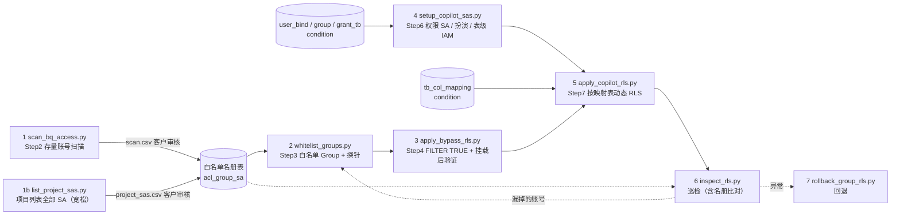

# BigQuery Data Copilot RLS 实施工具集

这是一套为 Data Copilot 场景实施 BigQuery 行级权限（Row-Level Security, RLS）的自动化脚本，覆盖实施方案的 Step 2–7，以及巡检和回退。

核心思路：
- **存量账号零感知**：所有存量读写账号放进全局白名单 Group，授予 `FILTER USING (TRUE)` 策略，不受行级限制。
- **只管控 Copilot**：行级细粒度管控只针对新建的 Copilot 权限 SA。
- **身份由引擎识别**：Copilot 后端用 API SA 扮演用户绑定的权限 SA 提交查询，BigQuery 通过 `SESSION_USER()` 识别身份，再查条件表过滤数据。

| 文档 | 内容 |
|---|---|
| **README.md**（本文） | 每个程序的功能、输入、处理逻辑、输出，以及前置条件和所需权限 |
| [RUNBOOK.md](RUNBOOK.md) | 演练 / 上线操作手册：每一步的输入、命令、校验、回退 |
| [TESTING.md](TESTING.md) | 做了哪些测试、测试环境、测试结果、测试中发现的问题 |

---

## 目录

- [整体流程](#整体流程)
- [文件清单](#文件清单)
- [通用前置条件](#通用前置条件)
- [通用约定](#通用约定)
- [程序详解](#程序详解)
  - [1. scan_bq_access.py：存量账号扫描](#1-scan_bq_accesspy存量账号扫描)
  - [1b. list_project_sas.py：项目列表下的全部 SA](#1b-list_project_saspy项目列表下的全部-sa宽松版白名单候选)
  - [2. whitelist_groups.py：白名单 Group 与探针](#2-whitelist_groupspy白名单-group-与探针)
  - [3. apply_bypass_rls.py：FILTER TRUE 白名单策略](#3-apply_bypass_rlspyfilter-true-白名单策略)
  - [4. setup_copilot_sas.py：Copilot 权限 SA 与授权](#4-setup_copilot_saspycopilot-权限-sa-与授权)
  - [5. apply_copilot_rls.py：按映射表动态生成行级策略](#5-apply_copilot_rlspy按映射表动态生成行级策略)
  - [6. inspect_rls.py：巡检](#6-inspect_rlspy巡检)
  - [7. rollback_group_rls.py：回退](#7-rollback_group_rlspy回退)
  - [8. 公共模块](#8-公共模块)
- [权限要求](#权限要求)
- [RLS 行为须知与实测发现](#rls-行为须知与实测发现)
- [常见问题排查](#常见问题排查)
- [附录：v1 原型脚本](#附录v1-原型脚本)

---

## 整体流程



每张目标表最终有两条策略：

| 策略名 | 授权对象 | 过滤条件 | 作用 |
|---|---|---|---|
| `rls_bypass_full_access` | 读、写白名单 Group | `TRUE` | 存量业务不受影响 |
| `rls_copilot_subquery_policy` | Copilot Group A（高）/ B（低） | 按条件表和映射表动态生成 | Copilot 行级过滤 |

### 客户权限表（8 张）与程序的对应关系

客户在方案「1014 最新权限表架构解析」里定义了 8 张权限表。程序直接读其中 6 张，不经过人工导出：

| 表 | 作用 | 字段 | 哪个程序怎么用 |
|---|---|---|---|
| `adm_user_mem_copilot_condition` | **RLS Lookup 主表** | `id, sa, region[], prdtype[], refername[]` | `apply_copilot_rls.py`：生成的策略子查询按 `c.sa = SESSION_USER()` 查它；`setup_copilot_sas.py`：给公共组授这一张表的 `dataViewer`；`inspect_rls.py`：检查 `CLUSTER BY sa`，并用 `sa` 列核对 Copilot 组成员 |
| `adm_user_mem_copilot_tb_col_mapping` | 目标表过滤字段映射 | `table_name, col_name, to_name` | `apply_copilot_rls.py` / `inspect_rls.py --mapping-table`：按表生成 / 核对过滤条件 |
| `adm_user_mem_copilot_group` | 表级权限组字典 | `id, group` | `setup_copilot_sas.py --auth-dataset`：把 `group_id` 翻译成 Group 邮箱 |
| `adm_user_mem_copilot_grant_tb` | Group → 授权表范围 | `group_id, table_name` | `setup_copilot_sas.py --auth-dataset`：表级 / 数据集级 `dataViewer` 的依据 |
| `adm_user_mem_copilot_user_bind` | 用户绑定中心表 | `id, role_id, condition_id, group_id` | `setup_copilot_sas.py --auth-dataset`：`condition_id → sa`、`group_id → group` 得到"哪个 SA 进哪个组"；违反"一 SA 一 Group"直接中止 |
| `adm_user_mem_copilot_acl_group_sa` | **全量白名单名册** | `sa, acl_group` | `whitelist_groups.py --acl-table`：按名册建组；`--acl-out` 把审核结果导出回名册；`inspect_rls.py --acl-table`：名册 vs. Group 实际成员双向比对 |
| `adm_user_mem_copilot_user` | 应用用户表 | `id, user, appid, bind_id` | 不使用——Copilot 后端路由层用它把登录用户解析到 `bind_id → condition_id → sa` |
| `adm_user_mem_copilot_role` | 角色字典 | `id, role` | 不使用 |

> [!NOTE]
> 所有读表的参数都有 CSV 备选（`--mapping-csv`、`--sa-file`、`--grants-file`、`--scan-csv`），用于客户还没建表、或只给清单文件的场景。
---

## 文件清单

| 文件 | 类型 | 说明 |
|---|---|---|
| [scan_bq_access.py](scan_bq_access.py) | 程序 | Step 2 存量账号扫描（读写分类，按表，较严格） |
| [list_project_sas.py](list_project_sas.py) | 程序 | Step 2 白名单候选的宽松版：列出项目列表下的全部 SA |
| [whitelist_groups.py](whitelist_groups.py) | 程序 | Step 3 白名单 Group、探针验证；也用于临时补加遗漏账号 |
| [apply_bypass_rls.py](apply_bypass_rls.py) | 程序 | Step 4 FILTER TRUE 白名单策略和挂载后验证 |
| [setup_copilot_sas.py](setup_copilot_sas.py) | 程序 | Step 6 Copilot 权限 SA、扮演授权、表级 IAM |
| [apply_copilot_rls.py](apply_copilot_rls.py) | 程序 | Step 7 按映射表动态生成行级策略 |
| [inspect_rls.py](inspect_rls.py) | 程序 | 巡检 |
| [rollback_group_rls.py](rollback_group_rls.py) | 程序 | 回退（按 group、表、策略名，带备份） |
| [rls_core.py](rls_core.py) | 公共模块 | 纯逻辑：解析、DDL 生成、各类计划、规范化、校验 |
| [gcp_ops.py](gcp_ops.py) | 公共模块 | GCP 调用封装：带传播延迟重试、探针、挂载后验证 |
| [gcp_auth.py](gcp_auth.py) | 公共模块 | 认证：ADC 或指定的 gcloud 账号 |
| [bq_sa_audit.py](bq_sa_audit.py) | 程序（v1） | 按项目审计 SA 的 BQ 权限和作业记录；它的 `RoleResolver` 被扫描脚本复用 |
| [setup_group_rls.py](setup_group_rls.py) | 程序（v1） | 单表、单 Group 的原型，已被 2 和 3 取代 |
| [tests/](tests) | 测试 | 148 个单元测试，38 个集成测试，见 [TESTING.md](TESTING.md) |
| [requirements.txt](requirements.txt) | 依赖 | Python 依赖 |

---

## 通用前置条件

### 本地环境

| 项 | 要求 |
|---|---|
| Python | 3.9 及以上（测试用的是 3.11） |
| 依赖 | `pip install -r requirements.txt`，包含 `google-auth`、`google-api-python-client`、`google-cloud-bigquery`；跑测试还需要 `pytest` |
| gcloud CLI | 已安装。使用 `--gcloud-account` 时必需 |

### 认证（所有程序通用）

| 方式 | 用法 | 说明 |
|---|---|---|
| ADC（默认） | `gcloud auth application-default login` | 适合长时间任务 |
| 指定 gcloud 账号 | `--gcloud-account ops@domain.com`（需要先 `gcloud auth login`） | token 到期前会自动重新获取，长时间任务不会中断；没有指定 quota project 时，回退到 `gcloud config` 的默认项目 |

### Quota project 与 API

用户凭证调用 Google API 时会带上一个 quota project，调用者要在这个项目上有 `serviceusage.services.use` 权限，而且要用到的 API 都已启用：

```bash
gcloud services enable bigquery.googleapis.com iam.googleapis.com cloudresourcemanager.googleapis.com \
    cloudidentity.googleapis.com iamcredentials.googleapis.com cloudasset.googleapis.com --project=<QUOTA_PROJECT>
```

| API | 用到它的程序 |
|---|---|
| bigquery | 全部 |
| iam | scan、setup_copilot_sas |
| cloudresourcemanager | scan、setup_copilot_sas，以及自动获取 customer ID |
| cloudidentity | whitelist_groups、setup_copilot_sas、inspect、rollback（`--delete-group`） |
| cloudasset | list_project_sas（`--organization` / `--folder`） |
| iamcredentials | 探针、挂载后验证（扮演 SA） |

---

## 通用约定

| 约定 | 说明 |
|---|---|
| 默认只演练 | 会修改资源的程序默认 dry-run，只打印计划；加 `--apply` 才执行 |
| 可重复执行 | 已完成的部分显示 `[NOOP]` 或 `[EXISTS]`，不会重复创建 |
| 列表参数 | 可以用空格或逗号分隔，例如 `--tables a.b.c,a.b.d`；`*-file` 参数是每行一个、`#` 开头为注释的文本文件 |
| 表名 | `project.dataset.table`，也接受 `project:dataset.table`；会校验标识符，防止注入 |
| 主体写法 | 不带前缀的邮箱：以 `*.gserviceaccount.com` 结尾的当作 `serviceAccount:`，其他默认当作 `group:`（白名单成员参数默认当作 `user:`）；也可以显式写 `user:` / `group:` / `serviceAccount:` 前缀 |
| 输出 | 计划和进度打印到 stderr，带标签：`[SOURCE]`（输入来自哪张表 / 文件）`[PLAN]` `[CREATE]` `[REPLACE]` `[NOOP]` `[CONFLICT]` `[SKIP]` `[ABORT]` `[ERROR]` `[OK]` `[EXISTS]` `[ISSUE]` `[WARN]` `[INFO]`。扫描类程序的逐行结果打印到 stdout |
| 退出码 | 0 表示成功；其他值的含义见各程序说明和 [RUNBOOK 附录 B](RUNBOOK.md#附录-b退出码速查) |

---

## 程序详解

### 1. scan_bq_access.py：存量账号扫描

**目的**（Step 2）：找出所有对目标表有读/写权限、或者真实读写过目标表的主体，按读写分类，生成白名单候选清单。

#### 输入

| 参数 | 必填 | 默认 | 说明 |
|---|:-:|---|---|
| `--tables` / `--tables-file` / `--datasets` | 至少一个 | — | 目标表；`--datasets` 为 `project.dataset`，展开为其中全部表（客户按数据集提供范围时使用） |
| `--jobs-days` | | 90 | 查最近 N 天的作业历史；0 表示不查 |
| `--regions` | | 表所在数据集的位置 | 作业历史查询哪些区域 |
| `--analyze-scope` | | — | `organizations/<id>` / `folders/<id>` / `projects/<id>`：对每张目标表（以及授权视图 / 数据集）调用 Cloud Asset `analyzeIamPolicy`，**展开 Group（含嵌套）并包含组织 / 文件夹层级继承的授权**。需要范围上的 `roles/cloudasset.viewer`，quota 项目启用 `cloudasset.googleapis.com` |
| `--no-authorized` | | 关闭 | 不追踪目标数据集 ACL 里的授权视图 / 授权数据集（默认追踪，R1） |
| `--no-expand-groups` | | 关闭 | 不递归展开候选里的 Group（默认展开：组内含 Copilot SA 的组不给白名单建议） |
| `--job-projects` | | — | 额外扫描这些项目的作业历史。作业历史存放在**提交作业的项目**里，从其他项目提交、读写目标表的作业只能在那个项目里看到 |
| `--jobs-scope` | | `project` | `organization`：改查 `JOBS_BY_ORGANIZATION`，一次覆盖全组织的作业（需要组织级 `bigquery.jobs.listAll`）。组织级视图没有 `query` 列，**该模式下不做通配符查询检测**（输出 `[INFO]` 提示） |
| `--copilot-members` | | — | Copilot API SA / 权限 SA 的邮箱，会被排除 |
| `--copilot-patterns` | | — | Copilot SA 邮箱的通配符，例如 `copilot-*@*` |
| `-o` / `--output` | | `scan_bq_access.csv` | 输出的 CSV |
| `--sa-projects-out` | | — | 把扫描到的 SA **所属项目**写成项目列表文件，直接喂给 `list_project_sas.py --projects-file`（项目列表不再靠人列） |
| `--project` | | 第一张表所在项目 | quota project，也是运行查询的项目 |

#### 处理逻辑

1. **项目级 IAM**：读取每张目标表所在项目的 IAM Policy。用 IAM API 把每个角色展开成具体权限（结果会缓存），有 `bigquery.tables.getData` 算可读，有 `bigquery.tables.updateData` 算可写。带条件的绑定会标记为 `(conditional)`。
2. **数据集 ACL**：读取目标表所在数据集的访问列表。legacy 角色按 `READER` → 读、`WRITER`/`OWNER` → 读写分类；IAM 角色按第 1 步的方式展开。授权视图、routine、dataset 类型的条目会跳过。
3. **表级 IAM**：读取每张目标表的 IAM 绑定，同样展开分类。
   - 3b. **授权视图 / 授权数据集**（R1，默认开启）：目标数据集 ACL 里授权的视图 / 数据集会读目标表的数据，经由它们查询时底表的 RLS **按查询者身份生效**（集成测试已验证），所以它们的读者也要进白名单。对每个授权视图读取其项目 / 数据集 / 视图三层 IAM，对授权数据集读取项目 / 数据集两层，有读或写权限的主体记为**可读**（来源 `authorized-view:<p.d.v>/project|dataset|table:...`、`authorized-dataset:<p.d>/...`）。只追一层。
   - 3c. **analyzeIamPolicy**（`--analyze-scope`）：对每张目标表及上面的授权对象查询 `bigquery.tables.getData` / `updateData`，Cloud Asset 会展开 Group（含嵌套）并包含组织 / 文件夹层级的继承授权。来源记为 `analyze:<资源>:<角色>`，经由 Group 时追加 ` via group:a > group:b`；经由授权对象时加前缀 `authorized:<对象>/`（只算可读）。结果不完整（`fullyExplored=false`）时打印 `[WARN]`。
4. **作业历史**（`--jobs-days > 0`）：按"项目 × 区域"查询 `INFORMATION_SCHEMA.JOBS_BY_PROJECT`。
   - 读：`referenced_tables` 里包含目标表；
   - 写：`destination_table` 是目标表，并且作业类型为 LOAD / COPY，或语句类型为 INSERT / UPDATE / DELETE / MERGE / CTAS / TRUNCATE；
   - 目标表通过 `@tables` 查询参数传入。
   - 这一步可以兜底 Folder/Org 层继承的权限。**跨项目提交的作业**需要用 `--job-projects` 把提交项目加进来，或者用 `--jobs-scope organization`。
   - 同时检测**通配符表查询**（R5）：在同一批作业里用正则查找对目标数据集的 `table_*` 引用，命中的账号记入 `wildcard_jobs` 列并在 `note` 里提醒。表启用 RLS 后这类查询会直接失败，需要提前改写 SQL。只有 `JOBS_BY_PROJECT` 有 `query` 列，所以 `--jobs-scope organization` 时跳过这一项。
5. **合并和建议**：同一主体在各个来源的结果合并。
   - Copilot SA：不给建议；
   - 可写或有写作业：建议 `write`；
   - 可读或有读作业：建议 `read`；
   - `specialGroup`、`domain` 等非具体账号：不给建议，备注里提示人工处理；
   - 另外几类会加备注：Google 托管服务代理；只出现在作业历史里的账号；只通过授权视图 / 数据集访问的账号；只经由 Group 获得权限的账号（可以单独加白名单，也可以把整个 Group 加入）。
   - analyze 返回的 `projectEditor:` / `projectViewer:` 等项目角色主体视同非具体账号。
6. **Group 展开**（默认开启，`--no-expand-groups` 关闭）：对有建议的 `group:` 候选用 Cloud Identity 递归展开。组内（含嵌套组）有 Copilot SA 时**清空建议**并在备注列出路径（整组加入会让 Copilot SA 命中 `FILTER TRUE`，`whitelist_groups.py` 也会拒绝），请把组内的存量账号单独加入；组读不到或有读不到的嵌套组时只加备注。

#### 输出

CSV 的列：

| 列 | 含义 |
|---|---|
| `principal` / `principal_type` | 主体（带前缀）和类型 |
| `can_read` / `can_write` | 根据 IAM 判断是否可读、可写 |
| `suggested_group` | 建议加入的白名单：`write` / `read` / 空 |
| `sources` | 权限来源，例如 `project:roles/bigquery.admin; dataset:dw:WRITER; table:t1:roles/bigquery.dataViewer` |
| `jobs_read_count` / `jobs_write_count` | 作业历史中的读、写次数 |
| `wildcard_jobs` | 使用通配符表查询目标数据集的次数（R5） |
| `copilot` | 是否命中 Copilot SA 规则 |
| `note` | 提示信息（服务代理、仅出现在作业历史、只经由授权视图、经由 Group、组内含 Copilot SA、非具体账号等） |

终端还会逐行打印，并在最后汇总写候选、读候选和排除的 Copilot SA 数量，以及 `[PROJECTS] 涉及的 SA 所属项目`（从 SA 邮箱反推：`x@<project>.iam.gserviceaccount.com`、`<project>@appspot...`、`<项目号>-compute@developer...`；Copilot SA 和 Google 托管服务代理不计）。

#### 示例

```bash
python scan_bq_access.py --tables prod-proj.dw.fact_orders,prod-proj.dw.fact_booking --jobs-days 90 \
    --job-projects etl-proj,bi-proj --copilot-patterns 'copilot-*@*' \
    --copilot-members copilot-api@proj.iam.gserviceaccount.com -o scan.csv
```
终端（stderr 是进度，stdout 是每个主体一行：`建议组 主体 [权限来源] jobs(读/写) 备注`）：
```
[IAM] 项目 prod-proj
[IAM] 数据集 prod-proj.dw
[IAM] 表 prod-proj.dw.fact_orders
[IAM] 表 prod-proj.dw.fact_booking
[JOBS] prod-proj / region-us（最近 90 天）
[JOBS] etl-proj / region-us（最近 90 天）
[JOBS] bi-proj / region-us（最近 90 天）
  [WARN] bi-adhoc@bi-proj.iam.gserviceaccount.com 最近 90 天有 3 次通配符表查询（目标数据集 ['prod-proj.dw']），表启用 RLS 后此类查询会失败（R5）
read  serviceAccount:bi-adhoc@bi-proj.iam.gserviceaccount.com  [project:roles/bigquery.dataViewer] jobs(r/w)=12/0 最近有 3 次通配符表查询（table_*），表启用 RLS 后会失败，需改写 SQL（R5）
-     serviceAccount:copilot-u-001@copilot-proj.iam.gserviceaccount.com  [] jobs(r/w)=21/0 Copilot SA，已排除出白名单; 仅出现在作业历史（可能来自 Folder/Org 继承或已回收权限），请人工确认
read  serviceAccount:iba-reader@bi-proj.iam.gserviceaccount.com  [table:fact_orders:roles/bigquery.dataViewer; table:fact_booking:roles/bigquery.dataViewer] jobs(r/w)=58/0
write serviceAccount:zeus-etl@etl-proj.iam.gserviceaccount.com  [dataset:dw:WRITER] jobs(r/w)=93/48
-     specialGroup:projectReaders  [dataset:dw:READER] jobs(r/w)=0/0 非具体账号，无法加入 Group，请人工处理
write user:admin@domain  [project:roles/bigquery.admin; dataset:dw:OWNER] jobs(r/w)=141/149

共 6 个主体：写白名单候选 2，读白名单候选 2，Copilot 排除 1，使用过通配符查询 1。结果已写入 scan.csv（请客户审核后再加组）
[PROJECTS] 涉及的 SA 所属项目 2 个（可作为 list_project_sas.py 的项目列表）: bi-proj, etl-proj
```

加 `--analyze-scope`，且目标数据集授权了一个视图时（节选）：
```bash
python scan_bq_access.py --tables prod-proj.dw.fact_orders --jobs-days 0 \
    --analyze-scope organizations/123456789012 --copilot-patterns 'copilot-*@*' -o scan.csv
```
```
[IAM] 表 prod-proj.dw.fact_orders
[AUTH-VIEW] 授权视图 prod-proj.mart.v_orders
[ANALYZE] prod-proj.dw.fact_orders（organizations/123456789012）
[ANALYZE] prod-proj.mart.v_orders（organizations/123456789012）
read  serviceAccount:report@bi-proj.iam.gserviceaccount.com  [authorized-view:prod-proj.mart.v_orders/table:roles/bigquery.dataViewer; authorized:prod-proj.mart.v_orders/analyze:projects/prod-proj/datasets/mart/tables/v_orders:roles/bigquery.dataViewer] jobs(r/w)=0/0 只通过授权视图 / 授权数据集访问目标数据（经由视图查询时底表 RLS 同样生效）
read  serviceAccount:etl-b@etl-proj.iam.gserviceaccount.com  [analyze:projects/prod-proj/datasets/dw:roles/bigquery.dataViewer via group:bi-readers@domain] jobs(r/w)=0/0 经由 Group 获得权限：可以把该账号单独加白名单，或把整个 Group 加入白名单（需确认组内没有 Copilot SA）
-     group:mixed@domain  [dataset:dw:roles/bigquery.dataViewer] jobs(r/w)=0/0 组内含 Copilot SA（copilot-u-001@copilot-proj.iam.gserviceaccount.com 路径 mixed@domain > inner@domain），不能整组加入白名单；请把组内的存量账号单独加入
```
`scan.csv`（节选）：
```
principal,principal_type,can_read,can_write,suggested_group,sources,jobs_read_count,jobs_write_count,wildcard_jobs,copilot,note
serviceAccount:zeus-etl@etl-proj.iam.gserviceaccount.com,serviceAccount,True,True,write,dataset:dw:WRITER,93,48,0,False,
serviceAccount:iba-reader@bi-proj.iam.gserviceaccount.com,serviceAccount,True,False,read,table:fact_orders:roles/bigquery.dataViewer; table:fact_booking:roles/bigquery.dataViewer,58,0,0,False,
serviceAccount:copilot-u-001@copilot-proj.iam.gserviceaccount.com,serviceAccount,False,False,,,21,0,0,True,Copilot SA，已排除出白名单; 仅出现在作业历史（可能来自 Folder/Org 继承或已回收权限），请人工确认
```

#### 局限
- 不加 `--analyze-scope` 时，Folder/Org 层的 IAM 不直接扫描，靠作业历史兜底；Group 内的账号也不单独列出（只在第 6 步做 Copilot 检查）。
- `INFORMATION_SCHEMA.JOBS` 最多保留 180 天；默认只查目标表所在项目的作业，跨项目作业要加 `--job-projects` 或用组织级视图。
- 授权视图 / 数据集只追一层；普通视图（非授权，查询者本身要有底表权限）由底表的 IAM 和作业历史覆盖。
- **有意不扫描**：`roles/bigquery.metadataViewer`（只看元数据）、`roles/bigquery.jobUser`（只能建作业）不读行数据，RLS 对它们没有影响；SA 模拟（`iam.serviceAccountTokenCreator`）不影响白名单——RLS 判断的是 `SESSION_USER()`，即被模拟的那个 SA，它自己会被扫描到。

---

### 1b. list_project_sas.py：项目列表下的全部 SA（宽松版白名单候选）

**目的**：`scan_bq_access.py` 只列出对目标表"有权限或真实访问过"的账号，比较保守，可能漏掉一些账号，例如权限来自 Folder/Org 且最近没跑过作业（不加 `--analyze-scope` 时）、或经由多层 View 间接访问的调度 SA。这个程序列出**项目列表中的所有 SA**，宁多勿漏。两者的输出格式相同，可以单独使用，也可以合在一起审核。

#### 输入

| 参数 | 必填 | 默认 | 说明 |
|---|:-:|---|---|
| `--projects` / `--projects-file` | 与下一行至少一个 | — | **项目列表**：空格或逗号分隔，或文件每行一个；重复的项目会去重。可以用 `scan_bq_access.py --sa-projects-out` 生成 |
| `--organization` / `--folder` | 与上一行至少一个 | — | **组织 / 文件夹范围**（ID 或 `organizations/<id>`）：用 Cloud Asset Inventory 盘点范围内**全部** SA，不需要项目列表。需要范围上的 `roles/cloudasset.viewer`（`cloudasset.assets.searchAllResources` / `searchAllIamPolicies`）和 `--quota-project`（已启用 `cloudasset.googleapis.com`） |
| `--iam-permission` | | `bigquery.tables.getData bigquery.tables.updateData` | 组织 / 文件夹范围下 `--include-iam-bound` 匹配的权限，可写多个，**任一命中即可**（OR；覆盖只有写权限的自定义角色） |
| `--no-expand-groups` | | 关闭 | 组织 / 文件夹范围下不展开绑定里的 Group（默认用 Cloud Identity 递归展开成 SA） |
| `--group` | | `write` | 这些 SA 建议加入哪个白名单：`write` / `read` |
| `--include-iam-bound` | | 关闭 | 项目范围：同时列出各项目**项目级** IAM Policy 里出现的 SA（跨项目 SA、Google 托管服务代理等）。组织 / 文件夹范围：列出**任何层级**（组织 / 文件夹 / 项目 / 数据集 / 表）授予了 `--iam-permission` 的 SA |
| `--include-disabled` | | 关闭 | 已禁用的 SA 也建议加入 |
| `--copilot-members` / `--copilot-patterns` | 强烈建议 | — | 排除 Copilot SA |
| `-o` / `--output` | | `project_sas.csv` | 输出的 CSV |
| `--quota-project` | | 第一个项目 | 组织 / 文件夹范围且没有项目列表时必填 |

#### 处理逻辑

1. **项目范围**：对列表里的每个项目，用 IAM API 列出项目内的全部 SA，包括邮箱、显示名、是否禁用（默认计算 SA、App Engine SA 等也在内）；加了 `--include-iam-bound` 时，再读取每个项目的**项目级** IAM Policy，把其中所有 `serviceAccount:` 成员加进来（来源记为 `iam-binding`）。
2. **组织 / 文件夹范围**（Cloud Asset Inventory）：`searchAllResources(assetTypes=iam.googleapis.com/ServiceAccount)` 列出范围内全部 SA（来源 `asset-sa`）；加了 `--include-iam-bound` 时，`searchAllIamPolicies(query="policy.role.permissions:bigquery.tables.getData OR policy.role.permissions:bigquery.tables.updateData")` 找出**任何层级**授予了读 / 写数据权限的 SA（来源 `资源简名:iam-binding:<角色>`，例如 `folders/42:iam-binding:roles/bigquery.dataViewer`、`projects/p/datasets/d/tables/t:iam-binding:roles/bigquery.dataViewer`）。数据集的 legacy ACL（READER/WRITER/OWNER）会以 `roles/bigquery.dataViewer/dataEditor/dataOwner` 的形式出现。
   - **Group 展开**：绑定里的 `group:` 成员（企业里常见的"SA 进组、组被授权"）用 Cloud Identity 递归展开（含嵌套组），组内的 SA 记为来源 `资源简名:iam-binding:<角色> via group:a > group:b`，终端打印 `[ASSET-GROUP]`；读不到的组（外部域 / 无权限）打印 `[WARN]`，其中的 SA 不会列出。需要对这些组的成员读取权限。
   - **范围外 SA**：授权里出现、但不在本范围 SA 盘点结果里的 SA（其他组织的 SA，或已删除的 SA）在 `note` 里标"范围外 SA（其他组织的 SA 或已删除的 SA），拿不到禁用状态，请重点审核"，照常建议加入。
   - Cloud Asset 请求遇到 429 / 5xx / 网络错误时按 2、4、8… 秒退避重试（最多尝试 6 次）。
3. 同一个 SA 在多个范围、多个来源中出现时合并成一行，`sources` 记录全部来源。
4. 决定是否建议加入：
   - 命中 Copilot 规则的 SA：不建议，`copilot=True`；
   - 已禁用的 SA：默认不建议（加 `--include-disabled` 时建议加入）；
   - 其余 SA：建议加入 `--group` 指定的白名单。
   - Google 托管服务代理（`service-<项目号>@...`、`*@gcp-sa-*`、`@cloudservices`、`@cloudbuild` 等）会在 `note` 里标注。
5. 某个范围 / 项目读取失败时打印 `[ERROR]`，其余照常输出，最后返回退出码 1。

#### 输出
CSV 的列和 `scan_bq_access.py` 相同，另外多了 `display_name`、`disabled` 两列，**可以直接作为 `whitelist_groups.py --scan-csv` 的输入**。终端最后会汇总：项目数、SA 总数、建议加入的数量、排除的数量。

#### 示例

`projects.txt`：
```
# ETL、BI、业务数据所在的全部项目（只支持整行注释）
prod-proj
etl-proj
bi-proj
```
```bash
python list_project_sas.py --projects-file projects.txt --group write --include-iam-bound \
    --copilot-patterns 'copilot-*@*' --copilot-members copilot-api@proj.iam.gserviceaccount.com -o project_sas.csv
```
```
[SA] prod-proj: 项目内 18 个 SA
[IAM] prod-proj: IAM 绑定中出现 82 个 SA
[SA] etl-proj: 项目内 6 个 SA
[IAM] etl-proj: IAM 绑定中出现 31 个 SA
[SA] bi-proj: 项目内 4 个 SA
[IAM] bi-proj: IAM 绑定中出现 27 个 SA
write serviceAccount:123456789012-compute@developer.gserviceaccount.com  [prod-proj:project-sa; prod-proj:iam-binding]
write serviceAccount:123456789012@cloudservices.gserviceaccount.com  [prod-proj:iam-binding] Google 托管服务代理
-     serviceAccount:copilot-api@proj.iam.gserviceaccount.com  [prod-proj:iam-binding] Copilot SA，已排除出白名单
write serviceAccount:iba-reader@bi-proj.iam.gserviceaccount.com  [bi-proj:project-sa; prod-proj:iam-binding]
write serviceAccount:zeus-etl@etl-proj.iam.gserviceaccount.com  [etl-proj:project-sa; prod-proj:iam-binding]
...

3 个项目，共 94 个 SA：建议加入 write 白名单 93 个，排除 Copilot SA 1 个，其他排除 0 个。结果已写入 project_sas.csv（请客户审核后再加组）
```
组织范围（不需要项目列表）：
```bash
python list_project_sas.py --organization 123456789012 --include-iam-bound --quota-project ops-proj \
    --copilot-patterns 'copilot-*@*' --copilot-members copilot-api@proj.iam.gserviceaccount.com -o org_sas.csv
```
```
[ASSET] organizations/123456789012: 范围内 1842 个 SA（Cloud Asset Inventory）
[ASSET-IAM] organizations/123456789012: 授予了 bigquery.tables.getData / bigquery.tables.updateData 的绑定中出现 211 个 SA（356 条，含组织 / 文件夹 / 项目 / 数据集 / 表级）
[ASSET-GROUP] organizations/123456789012: 绑定中出现 14 个 Group，递归展开得到 63 条 SA 授权
write serviceAccount:iba-reader@bi-proj.iam.gserviceaccount.com  [bi-proj:asset-sa; projects/prod-proj/datasets/dw/tables/fact_orders:iam-binding:roles/bigquery.dataViewer; projects/prod-proj/datasets/dw/tables/fact_booking:iam-binding:roles/bigquery.dataViewer]
write serviceAccount:zeus-etl@etl-proj.iam.gserviceaccount.com  [etl-proj:asset-sa; projects/prod-proj/datasets/dw:iam-binding:roles/bigquery.dataEditor]
write serviceAccount:legacy-report@old-proj.iam.gserviceaccount.com  [old-proj:asset-sa; folders/4201:iam-binding:roles/bigquery.dataViewer]
write serviceAccount:sched@etl-proj.iam.gserviceaccount.com  [etl-proj:asset-sa; projects/prod-proj/datasets/dw:iam-binding:roles/bigquery.dataViewer via group:bi-readers@domain]
write serviceAccount:partner-sync@partner-proj.iam.gserviceaccount.com  [projects/prod-proj:iam-binding:roles/bigquery.dataViewer] 范围外 SA（其他组织的 SA 或已删除的 SA），拿不到禁用状态，请重点审核
-     serviceAccount:copilot-u-001@copilot-proj.iam.gserviceaccount.com  [copilot-proj:asset-sa] Copilot SA，已排除出白名单
...

organizations/123456789012 + 0 个项目，共 1850 个 SA：建议加入 write 白名单 1847 个，排除 Copilot SA 3 个，其他排除 0 个。结果已写入 org_sas.csv（请客户审核后再加组）
```
上面 `legacy-report` 的权限来自 Folder 层——这是按表扫描看不到、项目范围也看不到的典型例子；`sched` 本身没有直接授权，是通过 Group 获得的；`partner-sync` 属于其他组织。

#### 什么时候用哪个

两种方式回答的问题不同，盲区也不同：

| | `scan_bq_access.py`（从表出发） | `list_project_sas.py` 项目范围 | `list_project_sas.py` 组织范围 |
|---|---|---|---|
| 回答的问题 | 谁能访问 / 访问过**这些表** | **这些项目**里有哪些 SA | **整个组织**里有哪些 SA、谁在任何层级被授了 BigQuery 读 / 写数据权限 |
| 能找到 | 目标表所在项目 / 数据集 / 表三层 IAM 里的任何主体（不管 SA 属于哪个项目）；授权视图 / 数据集的读者；作业历史里真实读写过的账号；`--analyze-scope` 时还有 Folder / Org 继承和经由 Group 的授权 | 列出项目拥有的全部 SA；`--include-iam-bound` 时这些项目**项目级** IAM 里的外部 SA | 范围内全部 SA；`--include-iam-bound` 时组织 / 文件夹 / 项目 / 数据集 / 表**任何层级**的授权（含经由 Group 的授权、其他组织的 SA） |
| 找不到 | 不加 `--analyze-scope` 时：权限来自 Folder / Org 层且窗口期内没跑过作业的账号；跨项目提交的作业（要 `--job-projects` 或 `--jobs-scope organization`） | 不在列表里的项目拥有的 SA；只在数据集 / 表级被授权的外部 SA；不判断是否访问过 BQ | 范围之外、且没有被授 BigQuery 权限的 SA；读不到的 Group 里的 SA；不判断是否访问过 BQ |
| 需要的权限 | 目标项目的 IAM / BigQuery 读权限（`--analyze-scope` 还要范围上的 `roles/cloudasset.viewer`） | 各项目 `iam.serviceAccounts.list` | 范围上的 `roles/cloudasset.viewer`；Group 展开要能读组成员 |

| 场景 | 推荐 |
|---|---|
| 想要精确、最小化的白名单 | `scan_bq_access.py` |
| 担心漏掉账号、希望"零中断"更稳妥，且有组织级权限 | `list_project_sas.py --organization <ORG_ID> --include-iam-bound`：不依赖人工项目列表，也补上了 Folder / Org 层授权 |
| 没有组织级权限 | 先 `scan_bq_access.py --sa-projects-out projects.txt` 得到数据驱动的项目列表，再 `list_project_sas.py --projects-file projects.txt --include-iam-bound` |
| 两者结合 | 分别生成后合并审核；把两个 CSV 依次传给 `whitelist_groups.py`（分两次执行即可，已经加入的账号会显示为已存在） |

> [!NOTE]
> SA 进入白名单意味着它能看到目标表的**全部行**（前提是它本来就有表的读权限）。宽松版不会额外授予表权限，只是让原本就能读的 SA 不受行级策略影响；但 Copilot SA 必须排除，脚本已经强制处理。

---

### 2. whitelist_groups.py：白名单 Group 与探针

**目的**（Step 3）：创建读、写白名单 Group，批量加入存量账号，并用探针确认 BigQuery 已经识别到成员关系。也用于**临时补加遗漏账号**：只往 Group 里加人，不动任何 RLS。

#### 输入

| 参数 | 必填 | 默认 | 说明 |
|---|:-:|---|---|
| `--write-group` / `--read-group` | 至少一个 | — | 写、读白名单 Group 的邮箱 |
| `--write-members` / `--read-members` | | — | 成员列表；不带前缀的邮箱当作 `user:`，`*.gserviceaccount.com` 当作 SA |
| `--write-members-file` / `--read-members-file` | | — | 成员文件 |
| `--scan-csv` | | — | `scan_bq_access.py` / `list_project_sas.py` 的输出，按 `suggested_group` 分配到对应 Group |
| `--acl-table` | | — | 客户的**白名单名册表** `adm_user_mem_copilot_acl_group_sa`（列 `sa, acl_group`），直接作为名单来源。`acl_group` 可以写 Group 邮箱（必须等于 `--write-group` / `--read-group`），或以 `write` / `read` 结尾的标识（如 `group_full_write`、`full_read`）；无法识别的值整体报错，不做任何变更 |
| `--acl-out` | | — | 把本次最终名单按 `sa,acl_group`（Group 邮箱）导出为 CSV，供客户 `bq load` 回填名册表 |
| `--copilot-members` / `--copilot-patterns` | 强烈建议 | — | 防止 Copilot SA 混入白名单 |
| `--project` / `--customer-id` | Group 不存在时需要其一 | — | 用来获取 Cloud Identity customer ID，以便创建 Group；`--acl-table` 也用它做 quota project |
| `--initial-config` | | `EMPTY` | `EMPTY`：执行账号不会成为组成员（推荐，需要 Groups Admin）；`WITH_INITIAL_OWNER`：执行账号成为 OWNER |
| `--probe-sa` / `--probe-dataset` | 建议 | — | 探针 SA 和探针数据集（`project.dataset`） |
| `--probe-timeout` | | 600 | 探针最长等待秒数 |
| `--allow-unverified-groups` | | 关闭 | 名单里的 Group 含有读不到的嵌套组（外部域 / 无权限）时仍继续。默认中止，因为无法确认里面没有 Copilot SA |
| `--apply` | | 只演练 | |

四种名单来源可以叠加，重复账号自动去重。

#### 处理逻辑

1. **汇总名单**：合并命令行、文件、扫描 CSV 和名册表里的成员，统一格式并去重。名册表的 `acl_group` 先按上表规则解析成 Group 邮箱；解析失败的行汇总后一次报出（`[ERROR] 白名单名册有误`，退出码 1）。
2. **防止 Copilot SA 混入**：只要有成员命中 `--copilot-members` 或 `--copilot-patterns`，就打印 `[REJECT]`，**退出码 2，不做任何变更**。
   - **嵌套组检查**：名单里的 `group:` 成员会用 Cloud Identity 递归展开（含多层嵌套）。Copilot SA 藏在嵌套组里同样会命中 `FILTER TRUE`，所以展开后命中也打印 `[REJECT] group:X 的嵌套成员 Y（路径 X > inner）…`，退出码 2；没有命中时打印 `[NESTED] group:X: 递归展开 N 个成员，未发现 Copilot SA`。
   - 读不到的组 / 嵌套组打印 `[UNVERIFIED]`，默认退出码 2 中止；确认没有 Copilot SA 后可加 `--allow-unverified-groups` 继续。
3. **打印计划**：逐行打印 `[PLAN] <group> <- <账号>`。`specialGroup`、`domain` 这类不能加入 Group 的条目会显示 `[SKIP]`。加了 `--acl-out` 时把计划写成名册 CSV。
4. **执行**（`--apply`）：
   - 查找 Group，不存在就用 Cloud Identity API 创建；
   - 列出现有成员，只添加缺少的（已存在或 409 都视为成功，Group 刚建好时的传播错误会重试）；
   - 加了 `--probe-sa` 时，探针 SA 也会加入每个 Group。
5. **探针验证**：对每个 Group，在探针数据集里建一张只有 1 行的表 `_rls_probe_<group>`，挂一条只授予这个 Group 的 `FILTER TRUE` 策略，并给探针 SA 这张表的读权限。然后**以探针 SA 身份**轮询 `COUNT(*)`，直到看到 1 行，输出 `[PROBE] <group> 已生效`；超时则输出未生效并返回退出码 1。

#### 输出与退出码
- 0：成功；1：名册表有误（未做任何变更）、有成员添加失败，或探针在超时内没有通过；2：名单中混入 Copilot SA（直接或经由嵌套组），或有读不到的嵌套组且没加 `--allow-unverified-groups`（都未做任何变更）。

嵌套组里藏了 Copilot SA 时：
```
[REJECT] group:bi-readers@domain 的嵌套成员 copilot-u-001@copilot-proj.iam.gserviceaccount.com（路径 bi-readers@domain > bi-inner@domain）命中 Copilot SA 名单/规则，禁止把该组加入白名单 group_full_read@domain
已中止，未做任何变更。请把上述 Copilot SA 移出这些组，或不要把这些组加入白名单。
```

#### 示例

名册表 `auth-proj.auth.adm_user_mem_copilot_acl_group_sa`：

| sa | acl_group |
|---|---|
| zeus-etl@etl-proj.iam.gserviceaccount.com | group_full_write@domain |
| admin@domain | group_full_write |
| iba-reader@bi-proj.iam.gserviceaccount.com | full_read |

```bash
python whitelist_groups.py --write-group group_full_write@domain --read-group group_full_read@domain \
    --acl-table auth-proj.auth.adm_user_mem_copilot_acl_group_sa --copilot-patterns 'copilot-*@*' \
    --project ops-proj --probe-sa probe-sa@ops-proj.iam.gserviceaccount.com --probe-dataset ops-proj.rls_probe --apply
```
```
[SOURCE] 白名单名册 auth-proj.auth.adm_user_mem_copilot_acl_group_sa: 3 行
===== 模式: APPLY =====
[PLAN] group_full_write@domain: 2 个成员
  group_full_write@domain <- zeus-etl@etl-proj.iam.gserviceaccount.com
  group_full_write@domain <- admin@domain
[PLAN] group_full_read@domain: 1 个成员
  group_full_read@domain <- iba-reader@bi-proj.iam.gserviceaccount.com
[GROUP] 已创建 group_full_write@domain (groups/03x8tuzt1k2m9ab)
[MEMBER] group_full_write@domain: 新增 3，已存在 0
[GROUP] 已创建 group_full_read@domain (groups/01hmsyys0q7w5cd)
[MEMBER] group_full_read@domain: 新增 2，已存在 0
[PROBE] group_full_write@domain 已生效
[PROBE] group_full_read@domain 已生效
===== 完成 (APPLY) =====
```
演练模式（不加 `--apply`）只打印到 `[PLAN]` 为止。名单里混进 Copilot SA 时：
```
[REJECT] serviceAccount:copilot-u-001@copilot-proj.iam.gserviceaccount.com 命中 Copilot SA 名单/规则，禁止加入白名单 group_full_read@domain
已中止，未做任何变更。请从名单中移除上述账号后重试。
```
从审核后的扫描 CSV 生成名册（`--acl-out acl.csv`）得到：
```
sa,acl_group
zeus-etl@etl-proj.iam.gserviceaccount.com,group_full_write@domain
admin@domain,group_full_write@domain
iba-reader@bi-proj.iam.gserviceaccount.com,group_full_read@domain
```

#### 前置条件
- 执行账号：Groups Admin。
- 探针：执行账号对探针 SA 有 TokenCreator；探针 SA 在 `--project`（或探针数据集所在项目）有 jobUser。

---

### 3. apply_bypass_rls.py：FILTER TRUE 白名单策略

**目的**（Step 4）：给多张目标表批量创建或维护同一条白名单策略，一次授予所有白名单 Group：

```sql
CREATE OR REPLACE ROW ACCESS POLICY `rls_bypass_full_access` ON `p.d.t`
GRANT TO ("group:full-write@x.com", "group:full-read@x.com") FILTER USING (TRUE)
```

#### 输入

| 参数 | 必填 | 默认 | 说明 |
|---|:-:|---|---|
| `--tables` / `--tables-file` | 二选一 | — | 目标表 |
| `--groups` | ✅ | — | 白名单 Group（可以写多个） |
| `--policy-name` | | `rls_bypass_full_access` | |
| `--merge` | | 关闭 | 已有同名策略但授权对象不同时，合并授权对象 |
| `--force-first-policy` | 表上原本没有 RLS 时必需 | 关闭 | 明确确认要创建首条策略 |
| `--verify-sa` | 强烈建议 | — | 挂载后用来验证的白名单 SA |
| `--verify-timeout` | | 300 | 验证最长等待秒数 |
| `--verify-mode` | | `sample` | `sample`：`SELECT 1 … LIMIT 1`，看到数据即通过，扫描量极小；`count`：`COUNT(*)` 与元数据行数比对（大表成本高） |
| `--skip-edition-check` / `--edition-days` | | 关闭 / 7 | 跳过 Reservation 版本检查 / 版本检查回看的天数 |
| `--project` | | 第一张表所在项目 | 运行 DDL 的项目 |
| `--apply` | | 只演练 | |

#### 处理逻辑

0. **Reservation 版本前置检查**：按表所在的项目和区域，查最近 N 天 `JOBS_BY_PROJECT` 里查询作业的 `edition`。只要有作业运行在 **STANDARD** 版本的 Reservation 上，就整批中止（退出码 5）——RLS 不支持 Standard 版本，策略挂上后存量查询会失败。按需计费（edition 为空）或 Enterprise 显示 `[EDITION] OK`；最近没有作业时无法判断，只提醒。
1. 读取每张表现有的全部策略，包括授权对象。授权对象通过 `rowAccessPolicies.getIamPolicy` 读出，在返回结果里体现为 `roles/bigquery.filteredDataViewer` 的成员。
2. 逐表决定怎么做：
   - 没有同名策略：`create`；
   - 同名策略的过滤条件和授权对象都一致：`noop`；
   - 过滤条件不同：`conflict`（不覆盖别人的策略）；
   - 授权对象不同：加了 `--merge` 时取并集再 `replace`，否则 `conflict`。
   - 比较过滤条件前会做规范化（见 [实测发现 3](#rls-行为须知与实测发现)）。
3. **首条策略保护**：如果有表原本没有任何 RLS 且要新建，先列出警告。`--apply` 时没加 `--force-first-policy`，**整批中止，退出码 2**。
4. 执行 create / replace 的 DDL；`noop` 打印 `[NOOP]`；`conflict` 打印 `[CONFLICT]`，跳过这张表，最后返回退出码 1。
5. **挂载后验证**（`--verify-sa`）：以验证 SA 身份轮询探测查询，直到能看到数据，输出 `[VERIFY-OK]`；超时输出 `[VERIFY-FAIL]`，退出码 1。
   - 默认 `sample` 模式执行 `SELECT 1 FROM 表 LIMIT 1`：验证 SA 只在白名单 Group 里，能看到任意一行就说明命中了 TRUE 策略，否则是 0 行；扫描量极小。
   - 表设置了**必须带分区过滤**时，自动加上 `<分区列> IS NOT NULL`（摄取时间分区用 `_PARTITIONTIME`）。
   - 表元数据行数为 0 时无法验证，输出 `[VERIFY-SKIP]`。

#### 示例

```bash
python apply_bypass_rls.py --tables prod-proj.dw.fact_orders,prod-proj.dw.fact_booking \
    --groups group_full_write@domain,group_full_read@domain \
    --force-first-policy --verify-sa iba-reader@bi-proj.iam.gserviceaccount.com --apply
```
```
===== 模式: APPLY  policy=rls_bypass_full_access  grantees=['group:group_full_write@domain', 'group:group_full_read@domain'] =====
[EDITION] prod-proj/us: OK（ENTERPRISE）
[WARNING] 以下 2 张表目前没有任何 RLS，创建后未被授权的账号将查不到数据:
  - prod-proj.dw.fact_orders
  - prod-proj.dw.fact_booking
[CREATE] prod-proj.dw.fact_orders
CREATE OR REPLACE ROW ACCESS POLICY `rls_bypass_full_access`
ON `prod-proj.dw.fact_orders`
GRANT TO ("group:group_full_write@domain", "group:group_full_read@domain")
FILTER USING (TRUE)
[CREATE] prod-proj.dw.fact_booking
CREATE OR REPLACE ROW ACCESS POLICY `rls_bypass_full_access`
ON `prod-proj.dw.fact_booking`
GRANT TO ("group:group_full_write@domain", "group:group_full_read@domain")
FILTER USING (TRUE)
[VERIFY-OK] prod-proj.dw.fact_orders: iba-reader@bi-proj.iam.gserviceaccount.com 可见数据（18s）
[VERIFY-OK] prod-proj.dw.fact_booking: iba-reader@bi-proj.iam.gserviceaccount.com 可见数据（2s）
===== 完成 (APPLY) =====
```
其他会看到的行：
```
[NOOP] prod-proj.dw.fact_orders                                                  # 重复执行
[CONFLICT] prod-proj.dw.fact_orders: 同名 policy 授权对象不同: ['user:x@domain']（如需合并授权对象请加 --merge）
[EDITION] prod-proj/us: 最近 7 天有 1532 个查询作业运行在 STANDARD 版本 Reservation admin-proj:US.std_res，RLS 不支持 Standard   # 退出码 5
已中止，未做任何变更。确认白名单 Group 已生效（探针通过）后加 --force-first-policy。   # 退出码 2
[VERIFY-OK] prod-proj.dw.fact_orders: iba-reader@... 1203 行（2s）                 # --verify-mode count
[VERIFY-FAIL] prod-proj.dw.fact_orders: 300s 内未达到可见: 403 Access Denied ...     # 验证 SA 不在白名单或没有表权限
```

#### 前置条件
- 白名单 Group 已经通过探针验证。
- 验证 SA 已在白名单 Group 里，对表有读权限，在 `--project` 有 jobUser，执行账号能扮演它。

---

### 4. setup_copilot_sas.py：Copilot 权限 SA 与授权

**目的**（Step 6）：搭建 Copilot 的权限体系——批量创建权限 SA，只允许 API SA 扮演它们；把它们加入表级 Group 和公共组；授予表级权限、条件表读权限和 jobUser。

**身份模型**（为什么需要这些输入）：Copilot 查询不能用用户个人邮箱，也不能用一个高权限 SA 直接查，否则 BigQuery 引擎分不清是谁在查，行级过滤无从做起。方案采用 **1 个 API SA + N 个权限 SA**：

> [!NOTE]
> **为什么脚本要输入 `--api-sa`？** 权限 SA 只是一个"身份外壳"——脚本创建它时**不生成任何密钥**，唯一能"变成"它的途径是扮演（`iam.serviceAccounts.getAccessToken`）。所以创建权限 SA 的同时必须回答"谁可以扮演它"，并把答案写进**权限 SA 自己的 IAM 策略**；按方案这个答案只有一个：Copilot 后端的 API SA。少了这一步，权限 SA 建出来也用不了（后端拿不到它的 token）。脚本**不会创建、也不会改动 API SA 本身**，只做两件事：① 在每个权限 SA 上把 API SA 登记为唯一的扮演者；② 检查 API SA 没有直接读数据的权限（有就退出码 3）——否则后端存在一条不经过权限 SA 的查询路径，RLS 形同虚设。

```
用户提问 → Copilot 后端（API SA）→ 查映射得到该用户的权限 SA
        → API SA 扮演权限 SA 提交查询 → BigQuery 中 SESSION_USER() = 权限 SA
        → RLS 策略用这个身份到条件表查该 SA 能看的行
```

| 角色 | 作用 | 脚本怎么处理 |
|---|---|---|
| **API SA**（`--api-sa`） | Copilot 后端自身的身份，只负责扮演权限 SA | 在每个权限 SA 上只给它授予 `roles/iam.serviceAccountTokenCreator`；检查它**没有任何数据读权限**（有则退出码 3） |
| **权限 SA**（`user_bind ⋈ condition ⋈ group`，或 `--sa-file`） | 代表一个用户或一组行权限相同的用户；一人一 SA 或一组一 SA | 批量创建；每个 SA 加入**一个**表级 Group，违反"一 SA 一 Group"直接中止 |
| **表级 Group A/B**（`grant_tb ⋈ group`，或 `--grants-file`） | 粗粒度：能不能读这张表。Group A 读全部目标表，Group B 只读非敏感表 | 给 Group 授予表级或数据集级 `dataViewer`。细粒度（能看哪些行）由 `apply_copilot_rls.py` 负责 |
| **公共组**（`--all-group`） | 所有权限 SA 共有的两项权限，统一授予 | ① 条件表**单表** `dataViewer`——RLS 子查询要读条件表，查询身份没有这个权限会报 `Access Denied: Table adm_user_mem_copilot_condition`；② 查询项目的 `roles/bigquery.jobUser`。对应方案预留的 `group_copilot_all_sa` |

#### 输入

| 参数 | 必填 | 默认 | 说明 |
|---|:-:|---|---|
| `--project` | ✅ | — | 权限 SA 所在项目 |
| `--api-sa` | ✅ | — | Copilot 后端 API SA |
| `--all-group` | ✅ | — | 所有权限 SA 的公共组 |
| `--condition-table` | ✅ | — | 条件表 `adm_user_mem_copilot_condition` 的全名（授单表读权限，也是 `user_bind.condition_id → sa` 的来源） |
| `--auth-dataset` | 与 CSV 二选一 | — | 权限表所在的 `project.dataset`，按文档默认表名读 `adm_user_mem_copilot_user_bind` / `_group` / `_grant_tb`；表名不同时用 `--bind-table` / `--group-table` / `--grant-table` 指定全名 |
| `--sa-file` / `--grants-file` | 与 `--auth-dataset` 二选一 | — | CSV 备选：`account_id,group[,display_name]`（`account_id` 也可以写完整邮箱）/ `group,resource`（resource 写到表就授表级权限，写到数据集就授数据集级权限）。两者可与表模式混用（例如 SA 来自表、授权来自 CSV） |
| `--job-project` | | `--project` | 承载查询的项目（给公共组授 jobUser） |
| `--customer-id` / `--initial-config` | | 自动获取 / `EMPTY` | 创建 Group 时用 |
| `--sa-limit` | | 100 | 单个项目的 SA 上限 |
| `--strict-impersonation` | | 关闭 | 存在项目级扮演风险时中止 |
| `--apply` | | 只演练 | |

表模式下脚本执行的两条 SQL（CSV 模式下客户可以用同样的 SQL 导出）：
```sql
-- 权限 SA -> Group（一 SA 一 Group）
SELECT DISTINCT LOWER(c.sa) AS sa, LOWER(g.`group`) AS grp
FROM `auth.adm_user_mem_copilot_user_bind` b
JOIN `auth.adm_user_mem_copilot_condition` c ON c.id = b.condition_id
JOIN `auth.adm_user_mem_copilot_group` g ON g.id = b.group_id;
-- Group -> 授权范围
SELECT DISTINCT LOWER(g.`group`) AS grp, t.table_name AS resource
FROM `auth.adm_user_mem_copilot_grant_tb` t JOIN `auth.adm_user_mem_copilot_group` g ON g.id = t.group_id;
```

#### 处理逻辑

0. **读入并校验输入**：打印 `[SOURCE]` 说明两类输入各来自哪张表 / 文件、多少行；同一个 SA 映射到多个 Group 时打印 `[ERROR] 一 SA 一 Group`，**退出码 1，不做任何变更**；条件表里的 SA 邮箱不属于 `--project` 时给出 `[WARN]`。
1. **SA 配额**：统计项目里现有的 SA 和需要新建的 SA；超过 `--sa-limit` 时**退出码 2**，不做任何变更（风险 R3）。
2. **API SA 不能有数据读权限**：检查项目 IAM、相关数据集的 ACL，以及授权表和条件表的表级 IAM；只要 API SA 拥有可读数据的角色，就**退出码 3**，强制所有查询必须通过扮演权限 SA 进行。
3. **项目级扮演风险**：把项目 IAM 的角色展开成权限，找出拥有 `getAccessToken` / `implicitDelegation` / `signBlob` / `signJwt` / `getOpenIdToken` 等扮演类权限的主体（API SA 除外）。
   - 可以处理的主体逐个列为 `[IMPERSONATION-RISK]`；
   - Google 托管服务代理只汇总成一行 `[IMPERSONATION-INFO]`；
   - 加了 `--strict-impersonation` 且存在可处理的风险时，退出码 4。
4. **打印计划**：列出所有 Group、SA、授权。
5. **执行**（`--apply`），每一步都输出 `[OK]`（新增）、`[EXISTS]`（已存在）或 `[ERROR]`：
   1. 确保所有涉及的 Group 存在；
   2. 创建 SA（已存在则复用）；
   3. 在**每个权限 SA 上**给 API SA 授予 `roles/iam.serviceAccountTokenCreator`；
   4. 把 SA 加入它的表级 Group 和公共组；
   5. 按授权范围给 Group 授予 `roles/bigquery.dataViewer`（表级或数据集级）；
   6. 给公共组授予**条件表的单表** `dataViewer`；
   7. 给公共组授予 `--job-project` 的 `roles/bigquery.jobUser`。

#### 退出码
0 成功；1 输入有误 / 一 SA 多 Group（未做任何变更）或部分失败；2 超出 SA 配额；3 API SA 有数据读权限；4 存在扮演风险（仅 `--strict-impersonation`）。

#### 示例

```bash
python setup_copilot_sas.py --project copilot-proj --api-sa copilot-api@proj.iam.gserviceaccount.com \
    --auth-dataset auth-proj.auth --all-group group_copilot_all_sa@domain \
    --condition-table auth-proj.auth.adm_user_mem_copilot_condition
```
```
===== 模式: DRY-RUN =====
[SOURCE] 权限 SA 清单: auth-proj.auth.adm_user_mem_copilot_user_bind ⋈ auth-proj.auth.adm_user_mem_copilot_condition ⋈ auth-proj.auth.adm_user_mem_copilot_group（2 行）
[SOURCE] 表级授权范围: auth-proj.auth.adm_user_mem_copilot_grant_tb ⋈ auth-proj.auth.adm_user_mem_copilot_group（4 行）
[INPUT] 权限 SA 2 个，表级授权 4 条，一 SA 一 Group: OK
[QUOTA] 现有 3 个 SA，新建 2 个，上限 100: OK
API SA 数据权限检查: OK
[IMPERSONATION-RISK] user:admin@domain 通过项目级 roles/iam.serviceAccountTokenCreator 可扮演项目内任意 SA（含权限 SA）
[IMPERSONATION-INFO] 另有 6 个 Google 托管服务代理具备扮演能力（由 Google 管理，通常无需处理）
  建议：回收上述项目级扮演权限，或把权限 SA 放在独立项目中
[PLAN] Group: ['group_copilot_all_sa@domain', 'group_copilot_high@domain', 'group_copilot_low@domain']
[PLAN] SA copilot-u-001@copilot-proj.iam.gserviceaccount.com -> group_copilot_high@domain, group_copilot_all_sa@domain; TokenCreator <- copilot-api@proj.iam.gserviceaccount.com
[PLAN] SA copilot-u-002@copilot-proj.iam.gserviceaccount.com -> group_copilot_low@domain, group_copilot_all_sa@domain; TokenCreator <- copilot-api@proj.iam.gserviceaccount.com
[PLAN] roles/bigquery.dataViewer on prod-proj.dw.fact_orders -> group:group_copilot_high@domain
[PLAN] roles/bigquery.dataViewer on prod-proj.dw.fact_booking -> group:group_copilot_high@domain
[PLAN] roles/bigquery.dataViewer on prod-proj.dw.fact_orders -> group:group_copilot_low@domain
[PLAN] roles/bigquery.dataViewer on prod-proj.dw_public -> group:group_copilot_low@domain
[PLAN] roles/bigquery.dataViewer on auth-proj.auth.adm_user_mem_copilot_condition -> group:group_copilot_all_sa@domain
[PLAN] roles/bigquery.jobUser on project copilot-proj -> group:group_copilot_all_sa@domain
```
加 `--apply` 后在计划之后逐项执行，每行 `[OK]` / `[EXISTS]`（完整输出见 [RUNBOOK 阶段 6](RUNBOOK.md#阶段-6创建-copilot-权限-sa-并授权step-6)）。一 SA 两 Group 时：
```
[ERROR] 一 SA 一 Group：copilot-u-001@copilot-proj.iam.gserviceaccount.com 同时映射到 ['group_copilot_high@domain', 'group_copilot_low@domain']
已中止，未做任何变更。请修正 adm_user_mem_copilot_user_bind（或 sas.csv）后重试。
```

---

### 5. apply_copilot_rls.py：按映射表动态生成行级策略

**目的**（Step 7）：按映射表 `adm_user_mem_copilot_tb_col_mapping`，为**多张字段各不相同的表**分别生成 `rls_copilot_subquery_policy`。

#### 输入

| 参数 | 必填 | 默认 | 说明 |
|---|:-:|---|---|
| `--mapping-table` / `--mapping-csv` | 二选一 | — | 映射来源，列为 `table_name,col_name,to_name` |
| `--condition-table` | ✅ | — | 条件表 |
| `--groups` | ✅ | — | Copilot Group A/B |
| `--tables` / `--tables-file` | | 映射表里的全部表 | **范围过滤器**：只处理列出的表，用于分批推广；列名、维度仍全部来自映射表（见下方说明） |
| `--default-project` | | 条件表所在项目 | `table_name` 只写了 `dataset.table` 时用来补全项目 |
| `--case-insensitive` | | 关闭 | 两侧都用 `UPPER()` 比较（业务表和条件表大小写不一致时使用，R6）；巡检时要带同样的参数 |
| `--bypass-policy-name` / `--policy-name` | | `rls_bypass_full_access` / `rls_copilot_subquery_policy` | |
| `--project` | | 条件表所在项目 | 运行 DDL 的项目 |
| `--apply` | | 只演练 | |

映射表的字段：
- `table_name`：目标表；
- `col_name`：目标表里真实的列名，可以是嵌套路径 `a.b`；
- `to_name`：条件表的标准维度，取值 `region` / `prdtype` / `refername`，不区分大小写。

> [!IMPORTANT]
> **`--tables` 是什么、不是什么。** 映射表 `adm_user_mem_copilot_tb_col_mapping` 是客户维护的**全量**配置（最终 100% 的表都在里面），脚本默认会给里面的每一张表挂策略。`--tables` / `--tables-file` 只决定**这一次动哪些表**——它不提供任何映射信息，列名和维度仍然全部来自映射表。没有它就做不了分批灰度，所以 RUNBOOK 阶段 7 / 9 每一批都用和阶段 4 相同的 `batch_N.txt`。
>
> | 情况 | 结果 |
> |---|---|
> | 不给 `--tables` | 处理映射表里的全部表 |
> | 给了，且表在映射表里 | 只处理这些表，其他表完全不碰 |
> | 给了，但某张表**不在映射表里** | 这张表输出 `[SKIP] …: 映射表中没有该表的过滤字段配置`，其余照常；最后退出码 1，提醒清单和映射表对不上。脚本不会"猜"列名 |
> | 表名只写 `dataset.table` | 用 `--default-project`（缺省为条件表所在项目）补全 |
>
> 注意 `inspect_rls.py` 的 `--tables` 语义不同：它是**必填**的巡检范围，映射表里没有的表也会巡检（只查白名单策略）。

#### 处理逻辑

1. **读取映射**：从 BigQuery 表或 CSV 读入，按表分组并去重，校验维度名和列名；加了 `--tables` 时只保留指定的表（映射里找不到的表输出 `[SKIP]`）。每张表打印一行 `[MAP] 表: 列->维度, ...`。
2. **按表结构校验**（每张表单独做）：读取表的 schema 并展开嵌套字段，检查每个映射的列：
   - 列必须存在；
   - 列本身和它的上级字段都不能是 REPEATED；
   - 不能映射到 RECORD 本身；
   - 类型必须是 STRING / INT64 / NUMERIC / BIGNUMERIC / BOOL / DATE 之一。
   - 不通过的表输出 `[SKIP] 表: 原因`，**只跳过这一张表**，最后返回退出码 1。
3. **生成过滤条件**：只为这张表映射到的维度生成条件，多个维度之间用 AND 连接。每个维度的条件如下：
   ```sql
   (<列表达式> IN (SELECT v FROM `<条件表>` AS c, UNNEST(c.<维度>) AS v WHERE c.sa = SESSION_USER())
    OR EXISTS (SELECT 1 FROM `<条件表>` AS c WHERE c.sa = SESSION_USER()
               AND (c.<维度> IS NULL OR ARRAY_LENGTH(c.<维度>) = 0)))
   ```
   - 列表达式：嵌套路径写成 `` `a`.`b` ``；非 STRING 列写成 `` CAST(`col` AS STRING) ``；`--case-insensitive` 时写成 `UPPER(...) IN (SELECT UPPER(v) ...)`；
   - 条件数组为 NULL 或空数组时，这个维度全部放行；
   - 子查询不引用目标表的列（BigQuery 不支持关联子查询），目标表的列放在 `IN` 的左边。
4. **白名单前置检查**：目标表上必须已有白名单策略。只要有一张表缺少，就输出 `[ABORT]`，**整批中止，退出码 2**，防止先挂 Copilot 策略触发"默认拒绝"、导致存量业务中断。
5. **逐表执行**：
   - 没有 Copilot 策略：`[CREATE]`；
   - 规范化后的过滤条件和授权对象都一致：`[NOOP]`；
   - 映射或 Group 有变化：`[REPLACE]`。

#### 示例：同一个维度在不同表里列名不同

| table_name | col_name | to_name | 这张表生成的条件 |
|---|---|---|---|
| p.d.orders | region | region | `` `region` IN ... `` |
| p.d.orders | prd_type | prdtype | `` AND `prd_type` IN ... `` |
| p.d.orders_alt | area | region | `` `area` IN ... `` |
| p.d.orders_alt | meta.ref | refername | `` AND `meta`.`ref` IN ... `` |
| p.d.t_int | prd_code (INT64) | prdtype | `` CAST(`prd_code` AS STRING) IN ... `` |

#### 示例：执行输出

```bash
python apply_copilot_rls.py --mapping-table auth-proj.auth.adm_user_mem_copilot_tb_col_mapping \
    --condition-table auth-proj.auth.adm_user_mem_copilot_condition \
    --groups group_copilot_high@domain,group_copilot_low@domain \
    --tables prod-proj.dw.fact_orders,prod-proj.dw.fact_booking --apply
```
```
===== 模式: APPLY  policy=rls_copilot_subquery_policy  grantees=['group:group_copilot_high@domain', 'group:group_copilot_low@domain'] =====
[MAP] prod-proj.dw.fact_orders: region->region, prd_type->prdtype, refername->refername
[MAP] prod-proj.dw.fact_booking: area_code->region, ext.ref_name->refername
[CREATE] prod-proj.dw.fact_orders
CREATE OR REPLACE ROW ACCESS POLICY `rls_copilot_subquery_policy`
ON `prod-proj.dw.fact_orders`
GRANT TO ("group:group_copilot_high@domain", "group:group_copilot_low@domain")
FILTER USING ((`region` IN (SELECT v FROM `auth-proj.auth.adm_user_mem_copilot_condition` AS c, UNNEST(c.region) AS v WHERE c.sa = SESSION_USER()) OR EXISTS (SELECT 1 FROM `auth-proj.auth.adm_user_mem_copilot_condition` AS c WHERE c.sa = SESSION_USER() AND (c.region IS NULL OR ARRAY_LENGTH(c.region) = 0))) AND (`prd_type` IN (...)) AND (`refername` IN (...)))
[CREATE] prod-proj.dw.fact_booking
CREATE OR REPLACE ROW ACCESS POLICY `rls_copilot_subquery_policy`
ON `prod-proj.dw.fact_booking`
GRANT TO ("group:group_copilot_high@domain", "group:group_copilot_low@domain")
FILTER USING ((`area_code` IN (...)) AND (`ext`.`ref_name` IN (...)))
===== 完成 (APPLY) =====
```
其他会看到的行：
```
[NOOP] prod-proj.dw.fact_orders                                               # 重复执行
[REPLACE] prod-proj.dw.fact_orders                                            # 映射或 Group 变了
[ABORT] prod-proj.dw.fact_new: 缺少白名单 policy `rls_bypass_full_access`      # 退出码 2，整批中止
[SKIP] prod-proj.dw.fact_booking: 列 area_cd（维度 region）在表中不存在          # 只跳过这张表，退出码 1
[SKIP] prod-proj.dw.fact_other: 映射表中没有该表的过滤字段配置
```

---

### 6. inspect_rls.py：巡检

**目的**：逐张表检查两条策略是否符合预期；检查白名单 Group 里有没有混入 Copilot SA、是否和白名单名册一致；检查条件表和 Copilot 组成员。适合每天定时运行。

#### 输入

| 参数 | 必填 | 说明 |
|---|:-:|---|
| `--tables` / `--tables-file` | ✅ | 要巡检的表 |
| `--bypass-groups` | ✅ | 白名单策略应包含的 Group |
| `--copilot-groups` | | Copilot 策略应包含的 Group |
| `--mapping-table` / `--mapping-csv` + `--condition-table` | | 用来计算 Copilot 策略的期望过滤条件 |
| `--whitelist-groups` | | 要检查成员的白名单 Group（默认取 `--bypass-groups` 里的 group） |
| `--copilot-members` / `--copilot-patterns` | | Copilot SA 的识别规则 |
| `--api-sa` | | Copilot API SA，检查它没有出现在 Copilot 组里 |
| `--acl-table` | | 白名单名册表 `adm_user_mem_copilot_acl_group_sa`；给出后与白名单 Group 的实际成员**双向比对** |
| `--write-group` / `--read-group` | | 名册里 `acl_group` 写的是 `write` / `read` 类标识时对应的 Group；不给则在 `--bypass-groups` 里找名字含 `write` / `read` 的 |
| `--probe-sa` | | 探针 SA，名册比对时忽略（它是 `whitelist_groups.py` 加进组的） |
| `--case-insensitive` | | 和 `apply_copilot_rls.py` 保持一致 |
| `--bypass-policy-name` / `--policy-name` / `--default-project` / `--project` | | 同上 |

#### 处理逻辑

1. **白名单策略**：存在；过滤条件规范化后是 `TRUE`；包含全部 `--bypass-groups`。
2. **Copilot 策略**（只检查映射里有的表）：存在；包含全部 `--copilot-groups`；过滤条件和"用当前映射和表结构生成的条件"规范化后一致。这样能发现映射改了但没重新执行，或者策略被人手工改过；映射配置本身有错误时也会报出来。
3. **白名单 Group 成员**：列出每个白名单 Group 的成员，检查有没有命中 Copilot 规则的账号；再**递归展开嵌套组**，Copilot SA 藏在嵌套组里也报 `[ISSUE] 白名单组 X 经由嵌套组 X > inner 混入 Copilot SA: y`；读不到的嵌套组（外部域 / 无权限）报 `[WARN]`。
4. **白名单名册比对**（`--acl-table`）：名册是白名单的事实来源。组里有、名册里没有的账号 → `[ISSUE]`（来历不明的全量权限）；名册里有、组里没有的账号 → `[ISSUE]`（漏加，存量任务会查不到数据）；名册里有无法识别的 `acl_group` 也是 `[ISSUE]`。
5. **条件表聚簇**（R4）：条件表的第一个聚簇字段必须是 `sa`，否则 `[ISSUE]`。
6. **Copilot 组成员**（给了 `--copilot-groups` 和 `--condition-table` 时）：
   - `[ISSUE]`：同一个 SA 同时在多个 Copilot 组（违反"一 SA 一组"）；API SA 出现在 Copilot 组里。
   - `[WARN]`（不影响退出码）：Copilot 组成员在条件表里没有条件行（这个 SA 会查不到任何数据）；条件表里的 sa 不在任何 Copilot 组（没有表级权限，条件不会生效）。
7. 每张表输出 `[OK]`，或者一行或多行 `[ISSUE]`，最后汇总问题数和提醒数。

#### 退出码
0 没有问题；1 发现问题（可以接告警）。

#### 示例

```bash
python inspect_rls.py --tables prod-proj.dw.fact_orders,prod-proj.dw.fact_booking \
    --mapping-table auth-proj.auth.adm_user_mem_copilot_tb_col_mapping \
    --condition-table auth-proj.auth.adm_user_mem_copilot_condition \
    --bypass-groups group_full_write@domain,group_full_read@domain \
    --copilot-groups group_copilot_high@domain,group_copilot_low@domain \
    --copilot-patterns 'copilot-*@*' --api-sa copilot-api@proj.iam.gserviceaccount.com \
    --acl-table auth-proj.auth.adm_user_mem_copilot_acl_group_sa --probe-sa probe-sa@ops-proj.iam.gserviceaccount.com
```
正常：
```
[OK] prod-proj.dw.fact_orders
[OK] prod-proj.dw.fact_booking
[ACL] 名册 auth-proj.auth.adm_user_mem_copilot_acl_group_sa: 4 行，已与 2 个白名单 Group 比对

巡检完成：2 张表，2 个白名单 Group，发现 0 个问题，0 个提醒
```
有问题（退出码 1）：
```
[OK] prod-proj.dw.fact_orders
[ISSUE] prod-proj.dw.fact_booking: `rls_copilot_subquery_policy` 过滤条件与映射表不一致: region = "HK"
[ISSUE] 白名单组 group_full_read@domain 中混入 Copilot SA: copilot-u-003@copilot-proj.iam.gserviceaccount.com
[ISSUE] 白名单组 group_full_read@domain 的成员 someone@domain 不在白名单名册中（来历不明的全量权限，请补录名册或移出组）
[ISSUE] 白名单名册中的 zeus-etl2@etl-proj.iam.gserviceaccount.com 还没有加入 group_full_write@domain（存量任务可能查不到数据，请热修补）
[ACL] 名册 auth-proj.auth.adm_user_mem_copilot_acl_group_sa: 5 行，已与 2 个白名单 Group 比对
[ISSUE] copilot-u-001@copilot-proj.iam.gserviceaccount.com 同时属于多个 Copilot 组: ['group_copilot_high@domain', 'group_copilot_low@domain']
[ISSUE] 白名单组 group_full_read@domain 经由嵌套组 group_full_read@domain > bi-inner@domain 混入 Copilot SA: copilot-u-005@copilot-proj.iam.gserviceaccount.com
[WARN] copilot-u-009@copilot-proj.iam.gserviceaccount.com 在 Copilot 组中但条件表没有条件行（该 SA 将查不到任何数据）

巡检完成：2 张表，2 个白名单 Group，发现 6 个问题，1 个提醒
```

---

### 7. rollback_group_rls.py：回退

**目的**：删除表上的行级策略。支持按 group、按策略名、全部删除，变更前会先备份。

#### 输入

| 参数 | 说明 |
|---|---|
| `--groups` / `--groups-file` | 可选。只处理授权对象里包含这些主体的策略 |
| `--tables` / `--tables-file` / `--datasets` / `--projects` | 至少一个。处理范围 |
| `--policy-names` | 可选。只处理这些名称的策略，例如只撤掉 `rls_copilot_subquery_policy` |
| `--strip-only` | 需要 group。共享的策略只去掉这些 group，不删整条 |
| `--backup-dir` | 变更前把整张表的策略（过滤条件、授权对象、可以直接重新执行的 DDL）备份为 JSON |
| `--revoke-table-viewer` | 需要 group。同时撤销这些 group 的表级 `dataViewer` |
| `--delete-group` | 需要 group。最后删除这些 Cloud Identity Group |
| `--quota-project` / `--apply` | |

#### 处理逻辑

1. 收集要处理的表（`--datasets` / `--projects` 会列出里面的所有表）。
2. 对每张表，读出全部策略和授权对象，然后决定删哪些：
   - 没给 group：删除 `--policy-names` 范围内的全部策略（没给策略名就是全部）；
   - 给了 group：删除授权对象里包含其中任一 group 的策略；加 `--strip-only` 时，只从共享策略里去掉这些 group，其他授权对象保留。
3. `--apply` 且给了 `--backup-dir` 时，先备份为 `<backup-dir>/<表>.<时间>.json`。
4. 执行：
   - 先执行"去掉 group"的重建（`CREATE OR REPLACE`，保留原过滤条件）；
   - **这张表的所有策略都要删时，用一条 `DROP ALL ROW ACCESS POLICIES`**（BigQuery 不允许单独删除最后一条策略），否则逐条 `DROP ROW ACCESS POLICY`；
   - 表上不再有任何 RLS 时会提示 `[NOTE]`。
5. 可选：撤销表级 `dataViewer`、删除 Group。

#### 恢复
备份文件里每条策略都有 `ddl` 字段，直接执行即可恢复。如果授权对象里有已删除的主体，`ddl` 为 null，需要手工处理。

#### 示例

```bash
python rollback_group_rls.py --tables prod-proj.dw.fact_orders \
    --policy-names rls_copilot_subquery_policy --backup-dir backup/ --apply
```
```
===== 模式: APPLY =====
[SCOPE] 未指定 group —— 将删除目标表上名称为 ['rls_copilot_subquery_policy'] 的 RLS
[SCAN] 共 1 张表待检查
[TABLE] prod-proj.dw.fact_orders  (共 2 条 RLS，删除 1 条，剥离 0 条)
  [BACKUP] backup/prod-proj.dw.fact_orders.20261023-220501.json
  [DROP] `rls_copilot_subquery_policy` filter=(region IN (
  SELECT
    v
  ...
)) grantees=['group:group_copilot_high@domain', 'group:group_copilot_low@domain']
    DDL: DROP ROW ACCESS POLICY `rls_copilot_subquery_policy` ON `prod-proj.dw.fact_orders`
    -> 完成
===== 完成 (APPLY)：1 张表，共处理 1 条 RLS =====
```
不加 `--policy-names` 时删除全部策略，最后一条自动改用 `DROP ALL ROW ACCESS POLICIES`，并提示 `[NOTE] 回退后该表已没有任何 RLS，所有有表读权限的用户可见全部行`。备份 JSON 的格式见 [RUNBOOK 附录 A](RUNBOOK.md#附录-a输入文件模板)。

---

### 8. 公共模块

| 模块 | 主要函数 | 说明 |
|---|---|---|
| `rls_core.py` | `split_items` / `normalize_member` / `parse_table` | 输入解析，标识符校验 |
| | `classify_permissions` / `classify_legacy_dataset_role` | 读写分类 |
| | `filter_whitelist_members` / `is_service_agent` / `impersonation_risks` | Copilot SA 识别、服务代理识别、扮演风险检测 |
| | `build_policy_ddl` / `build_bypass_policy_ddl` / `build_copilot_filter` / `build_copilot_policy_ddl` | DDL 生成 |
| | `parse_mapping_rows` / `flatten_schema` / `validate_mapping_against_schema` | 映射解析和按表结构校验 |
| | `normalize_filter` / `plan_policy_upsert` / `plan_rollback` | 过滤条件规范化，创建 / 合并 / 回退的决策 |
| | `inspect_policies` / `inspect_whitelist_membership` | 巡检规则 |
| | `check_sa_quota` / `sa_account_id` / `jobs_access_sql` / `wildcard_jobs_sql` / `edition_usage_sql` | 配额、SA 命名、作业历史 / 通配符检测 / 版本检查 SQL |
| | `visibility_probe_sql` / `standard_edition_usage` / `inspect_copilot_membership` / `inspect_condition_clustering` | 探测 SQL（自动分区过滤）、版本判断、Copilot 组巡检 |
| | `AUTH_TABLES` / `auth_table` / `bind_sa_group_sql` / `grant_scope_sql` | 客户权限表的默认表名、`--auth-dataset` 推导、读 `user_bind` / `grant_tb` 的 SQL |
| | `parse_sa_rows` / `parse_grant_rows` / `sa_group_conflicts` | 权限 SA / 授权范围输入解析（表和 CSV 两种形状），"一 SA 一 Group"校验 |
| | `resolve_acl_group` / `acl_roster` / `inspect_acl_roster` | 白名单名册解析与名册 vs. Group 成员比对 |
| | `sa_home_project(s)` / `asset_scope` / `asset_sa_rows` / `asset_iam_sa_rows` | SA 所属项目反推；Cloud Asset Inventory 范围与结果解析 |
| | `iam_permission_query` / `asset_iam_group_refs` / `build_sa_whitelist_rows` | CAI 权限查询（OR）、绑定里的 Group 引用、SA 行合并（含"范围外"标记） |
| | `expand_group` / `inspect_nested_copilot` | 递归展开 Group（带路径、防环、深度上限）；嵌套组 Copilot SA 检查 |
| | `analysis_principals` / `analysis_source` / `authorized_entries` | analyzeIamPolicy 结果解析（含 Group 路径）；数据集 ACL 里的授权视图 / 数据集 |
| `gcp_ops.py` | `list_policies` / `run_ddl` / `run_query` | BigQuery 操作 |
| | `table_add_role` / `dataset_add_reader` / `project_add_role` / `sa_add_role` | IAM 授权（遇到传播或并发冲突会重试） |
| | `ensure_group` / `group_members` / `add_group_member` / `lookup_group` | Cloud Identity 操作 |
| | `probe_group` / `verify_full_access` / `impersonate` / `condition_sas` / `RoleResolver` | 探针、挂载后验证、扮演、条件表 SA、角色展开 |
| | `asset_search_service_accounts` / `asset_search_iam_policies` / `analyze_access` / `execute_with_backoff` | Cloud Asset Inventory 搜索（分页）、analyzeIamPolicy；429 / 5xx 指数退避重试 |
| | `group_members_typed` / `expand_group` / `dataset_authorized` / `bq_full_resource_name` | 带类型的组成员（读不到返回 None）、递归展开；授权视图 / 数据集 |
| `gcp_auth.py` | `get_credentials` / `GcloudCredentials` | ADC，或指定 gcloud 账号；gcloud 账号的 token 到期会自动重新获取 |

---

## 权限要求

### 执行账号

| 程序 | GCP IAM（目标 / 相关项目） | Cloud Identity（Admin Console） |
|---|---|---|
| scan_bq_access | `resourcemanager.projects.getIamPolicy`、`iam.roles.get`、`bigquery.datasets.get`、`bigquery.tables.getIamPolicy`、`bigquery.jobs.listAll`（`--job-projects` 的每个项目也需要；`--jobs-scope organization` 需要**组织级**）、`bigquery.jobs.create`（推荐：`roles/iam.securityReviewer` + `roles/bigquery.resourceViewer` + `roles/bigquery.metadataViewer` + `roles/bigquery.jobUser`）；授权视图所在项目 / 数据集同样需要；`--analyze-scope` 需要范围上的 `cloudasset.assets.analyzeIamPolicy`（`roles/cloudasset.viewer`） | 展开候选 Group 时需要能读取组成员（读不到只加备注） |
| list_project_sas | 项目范围：每个项目 `iam.serviceAccounts.list`；`--include-iam-bound` 时需要 `resourcemanager.projects.getIamPolicy`（推荐：`roles/iam.securityReviewer`）。组织 / 文件夹范围：范围上的 `cloudasset.assets.searchAllResources` / `searchAllIamPolicies`（推荐：`roles/cloudasset.viewer`），quota 项目启用 `cloudasset.googleapis.com` | 展开绑定里的 Group 时需要能读取组成员（读不到打 `[WARN]`） |
| whitelist_groups | 探针：`bigquery.tables.create`、`bigquery.rowAccessPolicies.*`、`bigquery.tables.setIamPolicy`（探针数据集）；对探针 SA 有 `iam.serviceAccounts.getAccessToken`；自动获取 customer ID 时需要 `resourcemanager.projects.get` 和 `organizations.get`；`--acl-table` 时需要名册表的 `bigquery.tables.getData` | **Groups Admin**（建 Group、加成员；名单里有 Group 时还要能读取其嵌套成员） |
| apply_bypass_rls | `bigquery.rowAccessPolicies.list/getIamPolicy/create/update/setIamPolicy`、`bigquery.tables.get/getData`、`bigquery.jobs.create`；验证时对验证 SA 有 getAccessToken（推荐：目标数据集 `roles/bigquery.dataOwner` + `roles/bigquery.jobUser`） | — |
| setup_copilot_sas | `iam.serviceAccounts.list/create/getIamPolicy/setIamPolicy`、`resourcemanager.projects.getIamPolicy/setIamPolicy`、`iam.roles.get`、`bigquery.tables.getIamPolicy/setIamPolicy`、`bigquery.datasets.get/update`；`--auth-dataset` 时还需要 `user_bind` / `group` / `grant_tb` / `condition` 四张表的 `bigquery.tables.getData` 和 `bigquery.jobs.create`（推荐：`roles/iam.serviceAccountAdmin` + `roles/resourcemanager.projectIamAdmin` + `roles/bigquery.dataOwner`） | **Groups Admin** |
| apply_copilot_rls | 同 apply_bypass_rls，另外需要映射表的 `bigquery.tables.getData` | — |
| inspect_rls | `bigquery.rowAccessPolicies.list/getIamPolicy`、`bigquery.tables.get`、映射表 / 条件表 / 名册表读权限、`bigquery.jobs.create` | 能读取白名单 Group 及其嵌套组的成员 |
| rollback_group_rls | `bigquery.rowAccessPolicies.list/getIamPolicy/delete`（`--strip-only` 时还需要 create/update/setIamPolicy 和 `tables.getData`）、`bigquery.jobs.create`；`--revoke-table-viewer` 需要 `tables.getIamPolicy/setIamPolicy` | `--delete-group` 需要 Groups Admin |
| 全部 | quota project 上的 `serviceusage.services.use` | — |

### 运行时身份（由脚本授予或需要预先准备）

| 身份 | 需要的权限 | 由谁授予 |
|---|---|---|
| API SA | **每个权限 SA 上**的 `roles/iam.serviceAccountTokenCreator`；**不能有**任何数据读权限 | setup_copilot_sas（检查并授予） |
| 权限 SA | 通过表级 Group 获得目标表 `dataViewer`；通过公共组获得条件表 `dataViewer` 和 jobUser | setup_copilot_sas |
| 探针 SA | jobUser；执行账号能扮演它；**不能读业务表** | 预先准备；探针表的读权限由脚本授予 |
| 验证 SA | 已在白名单里的存量 SA，有表读权限和 jobUser；执行账号能扮演它 | 预先准备 |

> [!NOTE]
> Group 的管理权限不能通过 GCP IAM 授予，只能在 Google Admin Console 里分配（Super Admin、Groups Admin，或勾选了 Groups 权限的自定义管理员角色）。SA 对 Cloud Identity 来说属于外部成员，如果组织禁止外部成员，加 SA 会失败。

---

## RLS 行为须知与实测发现

1. **默认拒绝**：表上只要有一条 RLS，没被任何策略授权的账号查询结果就是 0 行（包括 Owner），DML 会报错。所以要先挂白名单策略，再挂 Copilot 策略；脚本已经强制这个顺序。
2. **RLS 不授予读表权限**：被授权的账号还需要表或数据集级的 `bigquery.tables.getData`。
3. **（实测）新建策略有十几秒的生效窗口**：即使白名单 Group 已经生效，新建 `rls_bypass_full_access` 后约 **16–18 秒**内，白名单账号仍可能查到 0 行，DML 也可能报 `does not have full access ... due to row access policies`。应对：选低峰执行；`--verify-sa` 等验证通过；ETL 调度要能重试。
4. **（实测）BigQuery 会重新排版存储的过滤条件**：去掉简单标识符外的反引号，换行缩进，`EXISTS (` 变成 `EXISTS(`。脚本比较前会规范化（字符串常量之外：去反引号、转小写、压缩空白、去掉标点两侧空白；字符串常量原样保留），所以重复执行能正确显示 `[NOOP]`。
5. **（实测）项目级扮演权限会绕过"只有 API SA 能扮演权限 SA"的设计**：拥有项目级 `roles/iam.serviceAccountTokenCreator` 等角色的主体，可以直接扮演任意权限 SA。`setup_copilot_sas.py` 会报告这类主体；建议回收，或者把权限 SA 放在一个单独的项目里。
6. **Group 成员关系同步有延迟**：一般 1–5 分钟，所以要用探针验证。
7. **RLS 需要 Enterprise 版本或按需计费**：Standard 版本的 Reservation 不支持 RLS。`apply_bypass_rls.py` 会先检查最近作业运行的版本，发现 Standard 就中止。
8. **其他限制**：表上有 RLS 后不支持通配符表查询（`table_*`，`scan_bq_access.py` 会检测近期用过的账号）；执行表复制、导出、`tabledata.list` 的账号需要命中 TRUE 策略（风险 R5）；子查询条件不参与分区裁剪（风险 R4）；子查询结果不能超过 100MB。
9. **（实测）授权视图不绕过底表 RLS**：经由授权视图查询时，底表的行级策略按**查询者**（`SESSION_USER()`）判断。只能读视图的账号不在白名单里，就查到 0 行——所以授权视图 / 数据集的读者也要进白名单，`scan_bq_access.py` 默认会追踪它们。
10. **Group 嵌套会让白名单"漏进" Copilot SA**：Copilot SA 只要经由任意层嵌套组属于白名单 Group，就会命中 `FILTER TRUE` 看到全部行。`whitelist_groups.py` 加组前、`inspect_rls.py` 巡检时都会递归展开检查。
11. **超大组织**：`searchAllIamPolicies` / `analyzeIamPolicy` 是同步接口，结果多时可能慢或不完整（脚本对 429 / 5xx 退避重试，analyze 结果不完整会打 `[WARN]`）。几十万资源级别的组织可以改用 `gcloud asset export`（`exportAssets` 导出到 BigQuery / GCS）或 `gcloud asset analyze-iam-policy-longrunning` 离线分析，再把结果整理成 CSV 交给 `whitelist_groups.py --scan-csv`。

---

## 常见问题排查

| 现象 | 原因 | 解决 |
|---|---|---|
| `403 USER_PROJECT_DENIED` | quota project 不可用 | 指定 `--project` / `--quota-project`，或设置 gcloud 默认项目 |
| `API [cloudidentity.googleapis.com] not enabled` | 没启用 API | 见[通用前置条件](#quota-project-与-api) |
| whitelist_groups 退出码 2 | 名单里混入 Copilot SA | 从名单里删掉 `[REJECT]` 列出的账号 |
| whitelist_groups `[REJECT] group:X 的嵌套成员 ...` | 要加入白名单的 Group 经由嵌套组包含 Copilot SA | 把 Copilot SA 移出该组，或改为把组内的存量账号单独加入 |
| whitelist_groups `[UNVERIFIED]` 退出码 2 | 名单里的 Group 有读不到的嵌套组（外部域 / 无权限） | 获取组的读取权限；或确认无 Copilot SA 后加 `--allow-unverified-groups` |
| 探针一直不通过 | 探针 SA 没有 jobUser、执行账号不能扮演它，或 Group 还没同步 | 检查权限；等待；加大 `--probe-timeout` |
| apply_bypass_rls 退出码 2 | 首条策略没加 `--force-first-policy` | 确认探针已通过后再加上 |
| apply_bypass_rls 退出码 5 | 最近有作业运行在 STANDARD 版本 | 先完成 Reservation 切换到 Enterprise（RUNBOOK 阶段 1） |
| `[VERIFY-FAIL]` 并显示 `Cannot query over table without a filter` | 旧版本脚本；当前版本会自动加分区过滤 | 升级脚本 |
| `[CONFLICT]` | 表上已有同名但内容不同的策略 | 查清来源；确认可以合并后加 `--merge` |
| `[VERIFY-FAIL]` 并显示 Access Denied | 验证 SA 没有表读权限，或不在白名单里 | 换一个合适的验证 SA |
| apply_copilot_rls 退出码 2 | 有表缺少白名单策略 | 先对这些表执行 apply_bypass_rls |
| `[SKIP] 列 x 在表中不存在` | 映射配置错误 | 修正映射表 |
| Copilot 查询报 `Access Denied: Table adm_user_mem_copilot_condition` | 权限 SA 没有条件表读权限 | 重跑 setup_copilot_sas（检查公共组的成员和授权） |
| setup_copilot_sas 退出码 3 | API SA 有数据读权限 | 回收输出里列出的权限 |
| setup_copilot_sas 退出码 1 且 `[ERROR] 一 SA 一 Group` | `user_bind`（或 `sas.csv`）里同一个 SA 绑了两个 Group | 修正数据后重跑，脚本在此之前不做任何变更 |
| setup_copilot_sas `[ERROR] 输入有误: 需要 --auth-dataset 或 --bind-table` | 既没给 CSV 也没给权限表位置 | 加 `--auth-dataset auth-proj.auth`，或 `--sa-file` + `--grants-file` |
| whitelist_groups 退出码 1 且 `[ERROR] 白名单名册有误` | 名册表 `acl_group` 值无法识别、`sa` 为空，或名册有写账号但没给 `--write-group` | 按提示逐行修正名册，或补齐 `--write-group` / `--read-group` |
| inspect_rls `[ISSUE] ... 不在白名单名册中` | 有人直接往白名单 Group 里加了账号（例如紧急热修补） | 补录到名册表；确认不该有的从 Group 里移除 |
| inspect_rls `[ISSUE] 白名单名册中的 ... 还没有加入` | 名册加了行但没有执行 `whitelist_groups.py --acl-table` | 重跑阶段 3 的命令 |
| 删除策略报 "use a DROP ALL statement" | 手工删了最后一条策略 | 用 rollback_group_rls（会自动改用 DROP ALL） |

---

## 附录：v1 原型脚本

| 脚本 | 功能 | 现状 |
|---|---|---|
| `bq_sa_audit.py` | 按项目列出 SA，判断有没有任何 BQ 权限（展开项目级角色，可选数据集 ACL），查 `INFORMATION_SCHEMA.JOBS` 判断是否提交过作业（自动识别区域），输出 CSV。参数：`--projects/--projects-file`、`--regions/--extra-regions`、`--days`、`--check-datasets`、`-o`、`--quota-project`、`--gcloud-account` | 可以继续用于按项目做 SA 盘点；Step 2 推荐用 `scan_bq_access.py`（按表，并分读写） |
| `setup_group_rls.py` | 读取 `bq_sa_audit.csv`，建一个 Group，加入 SA，给单张表建 TRUE 策略 | 已被 `whitelist_groups.py` 和 `apply_bypass_rls.py` 取代 |
